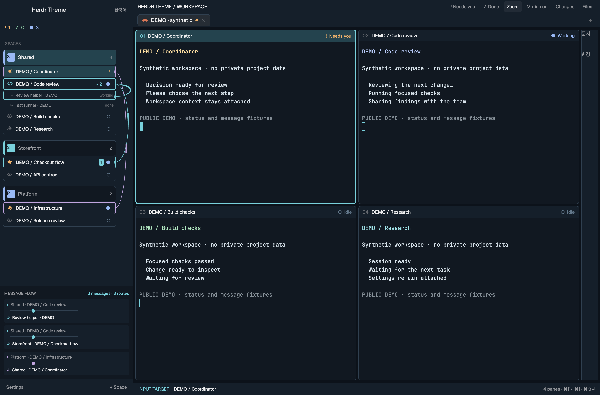

# Herdr Theme

여러 프로젝트의 워크스페이스와 에이전트를 왼쪽 패널 한 곳에서 관리하는 Herdr 테마입니다. 각 에이전트의 상태·미확인 메시지, 동시에 오가는 메시지 경로, 서브에이전트 관계를 현재 터미널을 유지한 채 확인합니다.

핵심은 화면 분할 수가 아니라 **프로젝트 간 작업 파악과 메시지 흐름 추적**입니다. 기본 6분할 외에도 현재 탭의 분할 구조를 그대로 사용할 수 있습니다.



- 선택 여부와 관계없이 모든 워크스페이스 아래 에이전트를 표시합니다.
- 워크스페이스 안에서는 승인 대기 → 완료 → 작업 중 → 대기 순으로 정렬합니다. 테마 전용 Claude·Codex 아이콘은 활동 중에 컬러와 가벼운 움직임으로 상태를 표시합니다. 왼쪽 행에는 순번을 붙이지 않고 미확인 메시지 개수만 표시합니다.
- 워크스페이스 제목을 드래그하면 순서가 저장됩니다.
- 상태는 각 에이전트 행에 표시하며, Ping 버튼이나 별도의 확인 대기 목록은 표시하지 않습니다.
- 선택 설치하는 `scripts/install_trace.py`는 `hc send`의 발신·수신·시간만 로컬에 최대 1024개 기록합니다.
  본문은 기록하지 않습니다. 여러 경로를 서로 다른 색과 연결선으로 동시에 표시하며, 메시지는 한 번 이동하고 도착 후 멈춥니다. 최근 경로·방향별 건수는 남고, ↻로 재전송 없이 경로만 다시 볼 수 있습니다. Motion으로 움직임을 끌 수 있습니다.
  이 실행기를 통하지 않은 RPC 메시지는 감지하지 못합니다. 음성 라우팅과도 별개입니다.
  기존 `~/.local/bin/hc`가 코어 심볼릭 링크이면 `python3 scripts/install_trace.py --default-launcher`로 기존 셸의 `hc send`도 기록할 수 있습니다. 알 수 없는 실행기는 덮어쓰지 않습니다.

## 설치

```sh
git clone https://github.com/chanyang721/herdr-theme.git
cd herdr-theme
python3 scripts/install.py
herdr-app check ~/.config/herdr-app/mods/sixfold-desk
herdr-app do layout.switch --name sixfold
```

기존 레이아웃과 다른 단축키는 보존합니다. 같은 이름의 테마가 이미 설치돼 있으면 덮어쓰지 않습니다.
업데이트는 Git diff를 검토한 뒤 이 저장소의 파일만 적용합니다.

- Cmd+[ / Cmd+]: 같은 탭의 이전·다음 pane
- Cmd+Option+1~6: 번호로 pane 선택
- Ctrl+Shift+방향키: 이웃 pane으로 이동
- Cmd+Shift+Enter: 현재 pane 확대
- Cmd+Shift+J / U: 승인 대기·완료 에이전트로 이동
- Cmd+W / Cmd+Shift+W: 실수로 닫지 않도록 비활성

`scripts/balance_grid.py`는 실행 중인 프로세스를 유지하고 6개 pane을 같은 크기로 맞춥니다.
`scripts/workspace.py`는 프로젝트별 6분할을 생성합니다. `--agents`를 주면 Claude 4개·Codex 2개를 시작합니다.

기존 TUI 세션은 선택 기능인 `scripts/tui_bridge.py`로 연결할 수 있습니다.
이는 새 런타임으로의 이력 변환이 아니라 기존 프로세스에 대한 실시간 연결입니다.
원래 TUI 서버를 유지해야 하며, 음성 라우팅·자동 전송은 별도 연동 대상입니다.

공개 미리보기는 데모 프로그램으로 촬영합니다. 실제 프로젝트나 대화 내용을 포함하지 않습니다.
상세 설명은 [English README](README.md), 재현 명세는 [RECIPE.md](RECIPE.md)를 참고하세요.

앱 대응 버전의 `herdr-focus-queue`가 설치돼 있다면 `python3 scripts/install_voice.py /path/to/herdr-focus-queue`로 선택한 pane의 음성을 연동할 수 있습니다. 음성 연결 종료와 마이크 음소거를 구분하며, 앱이 비활성 상태이면 TUI 포커스를 덮어쓰지 않습니다. 문장 종료 뒤 자동 전송은 음성 플러그인의 기존 규칙을 사용합니다.

메시지 개수는 워크스페이스를 누르지 않아도 0.25초마다 갱신합니다. 저장 내용이 같으면 다시 그리지 않습니다. 에이전트가 작업을 마치거나 해당 pane을 포커스하면 개수가 사라지고, 읽은 위치는 `data/sixfold/messages-read.json`에 저장되어 재시작해도 다시 쌓이지 않습니다. 공통→프로젝트 같은 위치 전달과 빈 pane 대체는 [COMMON_ROUTING.md](COMMON_ROUTING.md)를 따르며, `python3 scripts/route.py --enable`로 현재 checkout의 대기열 처리를 연결합니다. 공통 알림은 `data/sixfold/alerts.json`을 읽으며 수집기는 별도입니다.

서브에이전트는 부모 에이전트 행의 `▸ N`으로 펼칩니다. 자식이 없어도 부모 행은 유지하며, 실제 위임이 새로 관측되면 자식 목록과 곡선 흐름을 함께 표시합니다. 워크스페이스 제목에는 메시지 합계를 표시하지 않고 에이전트 행에만 개수를 표시합니다.

`scripts/collect_workflow.py`는 Claude 메타데이터, 읽기 전용 Codex DB, hc의 부모 관계로 `data/sixfold/workflow.json`을 만듭니다. `--once`는 한 번 수집하고, 기본 실행은 3초마다 바뀐 내용만 기록합니다. 실행 상태가 명시되지 않은 기록에는 추정 표시가 붙습니다. 첫 시작의 기존 위임은 애니메이션으로 재생하지 않습니다. 이 수집기의 상시 실행 등록은 별도이며, 테마 설치만으로 자동 등록하지 않습니다.

프로젝트 아이콘은 `python3 scripts/set_workspace_icon.py '워크스페이스 ID 또는 정확한 이름' /path/to/icon.png`로 지정합니다. SVG·PNG·JPEG·WebP를 지원하며 `--background '#ffffff'`, 단색 SVG의 `--tint`를 선택할 수 있습니다. 파일은 이 기기의 `data/sixfold/icons/`에 복사하고 설정은 `workspace-icons.json`에 저장합니다. 변경은 테마를 재시작하지 않아도 반영되며 고객 로고 파일은 공개 저장소에 포함하지 않습니다.

## Optional document and usage tools

Separate mod recipes let you place document and usage tools in a personal layout. [Project Document Viewer](extras/preview/README.md) adds saved-file Markdown preview and local HTML snapshots. [System Metrics](extras/system-metrics/RECIPE.md) adds a separate CPU/memory strip. Token history is available from [Insights](https://github.com/GaganSD/coding-agent-toolkit/tree/main/herdr-insights); subscription quotas come from [Usage Bar](https://github.com/berkeatac/herdr-usage-bar). These are optional, separate installs; account quotas are not per-agent token totals.

Independent mod releases: [System Metrics](https://github.com/chanyang721/herdr-workspace-mods/tree/main/system-metrics) · [Project Document Viewer](https://github.com/chanyang721/herdr-workspace-mods/tree/main/document-viewer).

Project document tracking: see [configuration and collector](docs/project-documents.md). The base theme uses full-width terminals; configured latest documents live in the left sidebar.
