# Herdr Theme

Herdr용 워크스페이스 사이드바와 터미널 레이아웃입니다. 여러 컴퓨터의 코딩 에이전트, 공동 프로젝트와 메시지를 보고, 터미널 옆에서 도구 상태와 사용량을 확인합니다.

[English](README.md)

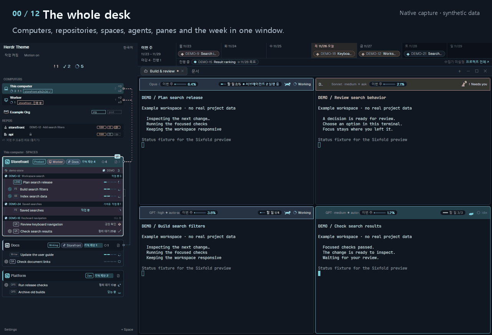

격리한 데모 앱에 합성 데이터를 넣고 찍은 네이티브 캡처 12개 장면입니다. 실제 업무를 녹화한 것이 아닙니다. [움직임 없는 첫 장면](docs/media/workflow-poster.png).

## 주요 기능

- **컴퓨터와 공간:** 컴퓨터별 에이전트 수, 각 컴퓨터가 실행 중인 커밋을 보여 주는 설치 칩, 공동 프로젝트·역할 묶음 칩, 공간별 알림, 메시지 경로(같은 컴퓨터는 실선, 다른 컴퓨터는 점선).
- **저장소:** 선택적 `repo_flow` 피드가 주는 저장소별 REPOS 줄. PUSH·CI·CD 단계와 배포 대상을 표시합니다.
- **작업 표시:** 선택적 로컬 피드의 이슈 묶음, 직무 칩(`LEAD`, `FE`, `QA` …), 단계 막대, 7가지 에이전트 상태, 배분·검수 이벤트, 기억 제안 배지가 붙는 정리 단계. 작업 관리는 피드 제공 도구가 맡고 테마는 이를 표시합니다. 명시된 대기 사유는 한 줄의 기존 진행 표시 영역에 짧게 표시하며, 전체 사유는 마우스를 올려 확인합니다.
- **이슈:** 이번 주·마일스톤·전체·알림 탭이 있는 이슈 팝업. `data/sixfold/issue-start.json`에 명령을 설정하면 이슈 상세의 **작업 시작**이 고른 에이전트·난이도로 그 이슈를 시작하고 어디로 갔는지 보여 줍니다.
- **확인 요청:** 권한·질문·계획 카드가 요청한 공간 카드 옆 탭에서 기다립니다. 다른 공간의 요청은 저절로 열립니다.
- **터미널 헤더:** 에이전트 상태·모델·추론 강도·세션 사용량과 움직이는 고양이. 모션을 끌 수 있습니다. Claude 칸에는 할 일 진행률(`할 일 2/5`)과 실행 중인 서브에이전트 수도 나오며, Agent Usage가 Claude 자체 기록에서 읽습니다(2분마다 갱신, 6분 넘게 갱신이 없으면 숨김).
- **모니터 스트립:** 고정 버전의 [Workspace Mods](https://github.com/chanyang721/herdr-workspace-mods)가 제공하는 CPU/RAM, MCP 연결, CLI 로그인 상태, Claude/Codex 한도와 세션별 토큰.
- **프로젝트 문서:** 공간별 문서 찾기, 고정, 공간마다 붙는 **문서** 탭. 선택적 파일 뷰어에서 터미널 옆에 Markdown을 띄웁니다.
- **이번 주:** 터미널 위 띠가 요일별 마감 이슈를 보여 주고, 타임라인 창이 이번 주를 프로젝트별로 묶습니다.

## 화면으로 따라가는 워크플로우

GIF는 전체 화면과 12개 장면을 39프레임, 약 64초로 보여 줍니다. 프레임마다 격리 데모 앱의 네이티브 캡처 한 장을 줄여 넣었습니다. 위 설명 띠와 테두리는 문서용이고 안쪽 화면은 바꾸지 않았습니다. 데모의 이벤트·알림·요청은 로컬 피드 파일에 직접 써 넣은 것이므로 **실제 작업이 처음부터 끝까지 실행된 녹화가 아닙니다.** [원본·표시 영역·재생 시간](docs/media/workflow-manifest.json) · [캡처 방법](docs/media/README.md).

| 1. 이슈에서 작업 시작 | 2. 분담과 배분 |
| --- | --- |
| 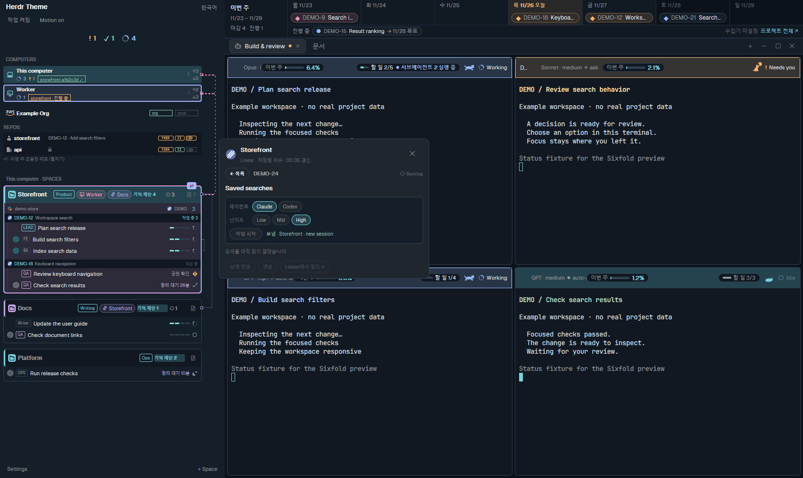 | 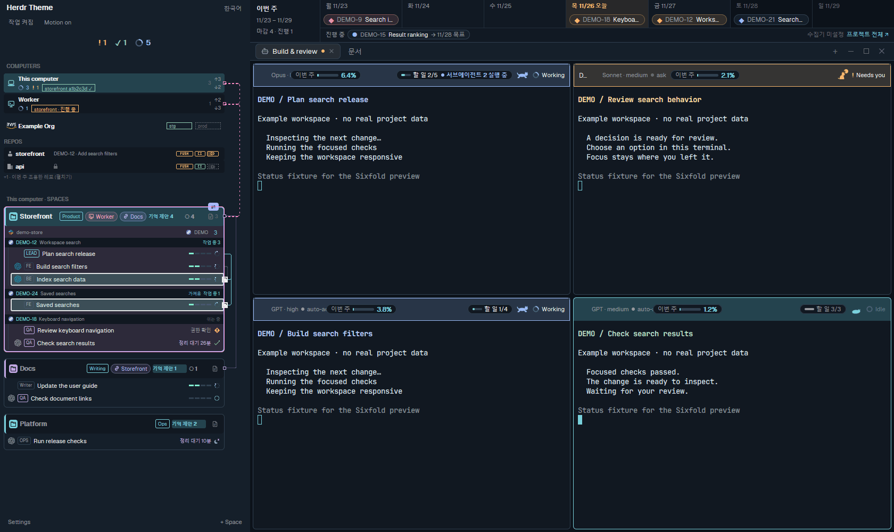 |
| 에이전트와 난이도를 고르고 작업 시작을 누릅니다. 옆 줄에 일이 어디로 갔는지 나옵니다. | 새 작업은 이슈 아래 자리표시 줄로, 배분은 리드 줄의 표시로 나옵니다. 칩이 직무를 보여 줍니다. |

| 3. 단계와 상태 | 4. 메시지 |
| --- | --- |
| 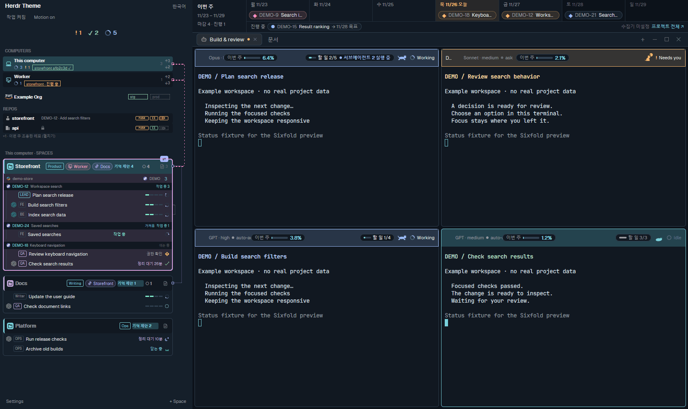 |  |
| 줄마다 단계 막대와 상태 표시가 있습니다. 닫힌 줄은 사라지기 전에 닫힘으로 나옵니다(9번 장면). | 같은 컴퓨터의 공간은 실선, 다른 컴퓨터로는 점선으로 이어집니다. |

| 5. 공간별 알림 | 6. 카드 옆 확인 요청 |
| --- | --- |
| 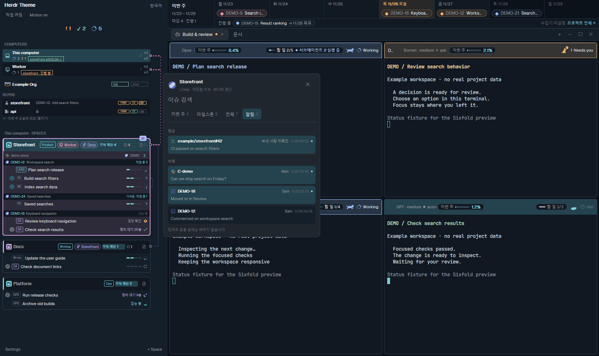 | 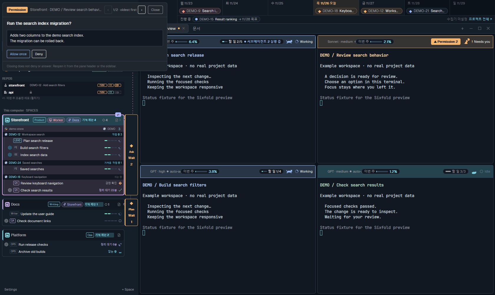 |
| Slack·Linear·GitHub 알림이 그 공간에 붙어 시간별로 묶입니다. | 공간 옆 탭이 그 공간의 요청을 오래된 순으로 엽니다. |

| 7. 검수·판정·수락 | 8. 푸시·CI·배포 |
| --- | --- |
|  | 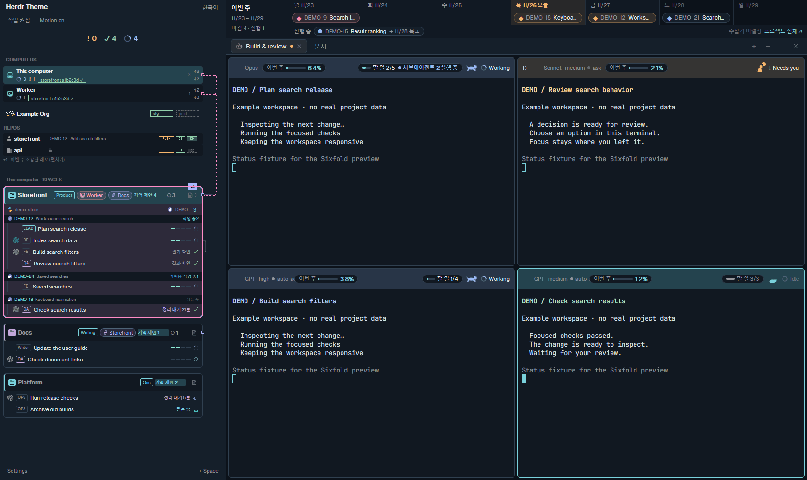 |
| 검수 요청, 판정, 담당자의 수락은 서로 다른 이벤트입니다. | REPOS가 단계를, 설치 칩이 컴퓨터별 실행 커밋을 보여 줍니다. |

| 9. 정리와 기억 | 10. 칸 머리 |
| --- | --- |
|  |  |
| 끝난 줄은 보고, 결정 저장, 기억 제안을 거쳐 닫힙니다. 공간의 기억 제안 배지가 제안 수를 셉니다. | 칸마다 모델·추론 강도·권한·주간 사용량·할 일·실행 중 서브에이전트를 보여 줍니다. |

| 11. 문서 | 12. 이번 주 |
| --- | --- |
| 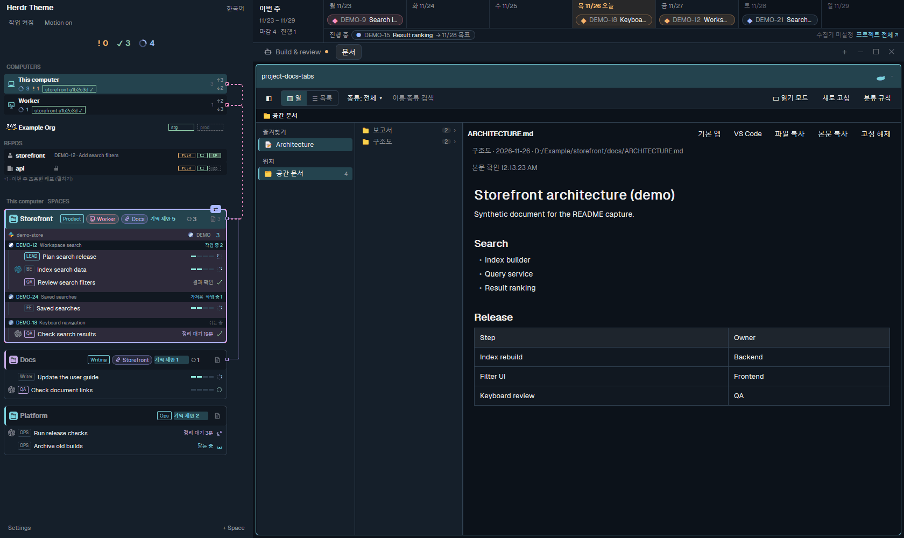 | 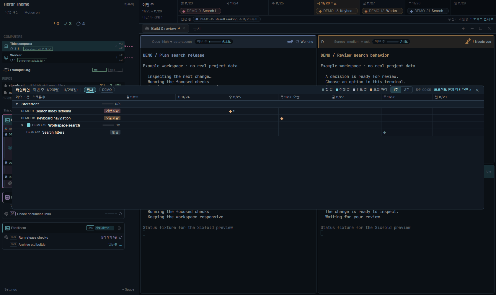 |
| 공간 문서를 검색하거나 그 공간의 문서 탭에서 봅니다. [문서 찾기](docs/images/walkthrough/docs-finder.png). | 띠는 요일별 마감 이슈를, 창은 프로젝트별 이번 주를 보여 줍니다. |

데모에서 보이지 않는 것:

- 이슈 상세 본문은 "아직 읽지 않았습니다"로 나옵니다. 데모에 이슈 상세 수집기가 없습니다.
- 이번 주 띠에 "수집기 미설정"이 나옵니다. 데모에 타임라인 수집기가 없어 미리 만든 주간 파일을 읽습니다.
- 모니터 스트립은 이 레이아웃에 없습니다. 아래 기능별 화면에 따로 있습니다.
- 메시지와 다른 이벤트는 코어의 전송 이벤트가 아니라 데모 피드에서 왔습니다. [메시지 이펙트의 지원 범위](#메시지-이펙트의-지원-범위)를 보세요.

[예전 이벤트·상태 갤러리](docs/panel-validation.md).

## 기능별 화면

### 컴퓨터·공동 프로젝트·이슈 연결

| 다크 | 라이트 |
| --- | --- |
| 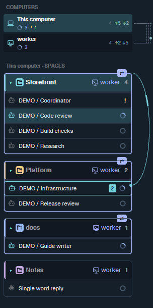 | 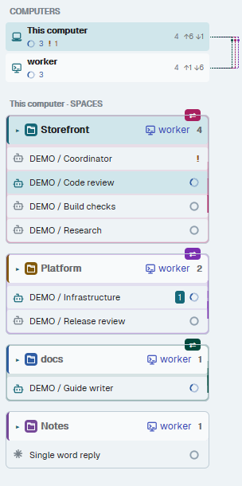 |

컴퓨터 선택, 공동 프로젝트 연결, Slack·Linear/Jira 공급 데이터, 이슈별 에이전트를 한 패널에서 봅니다. 실제 계정 연결은 별도 설정입니다. [공유·도구·Slack 조합별 48개 화면](docs/panel-validation.md).

### 저장소와 배포

| 전 | 후 |
| --- | --- |
|  |  |

저장소 줄마다 PUSH·CI·CD를 보여 줍니다. 회사 저장소는 제공자와 스테이지·운영 대상을 함께 보여 줍니다. 컴퓨터 이름 아래 설치 칩은 실행 중인 커밋이나 배포 진행 중을 표시합니다. 데이터는 선택적 제공 도구가 줍니다. [피드의 저장소 단계](docs/panel-feed.md#optional-space-notifications-pending-requests-and-repository-stages).

### 알림과 확인 요청

| 다른 공간의 요청 | 한 공간의 알림 |
| --- | --- |
| 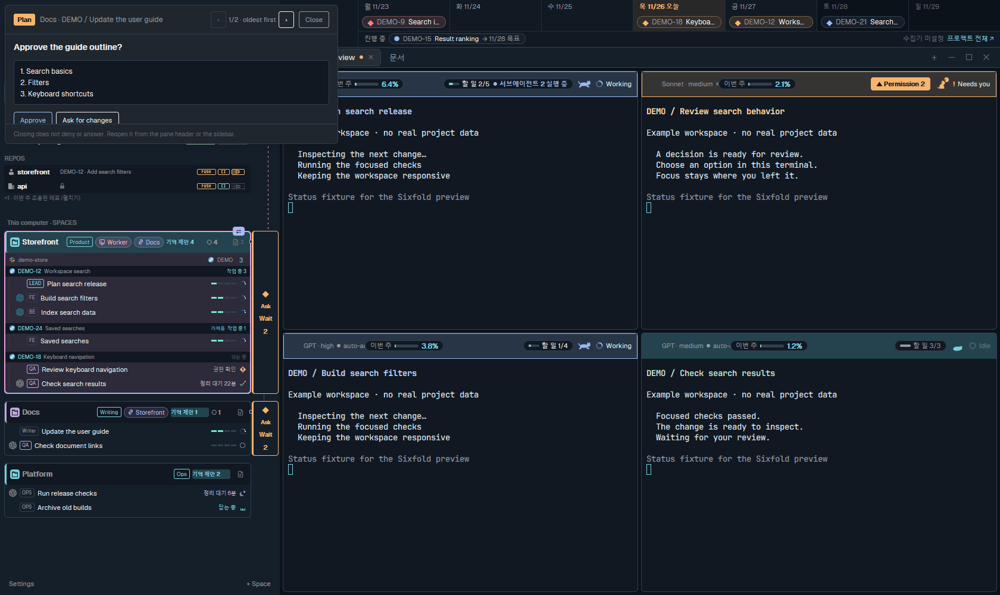 |  |

요청은 설정한 카드 연결 도구에서 옵니다. 팝업을 닫아도 답하거나 거절한 것이 아니며, 탭이나 칸 머리에서 다시 엽니다. [카드와 설정한 명령](docs/local-integrations.md#cards-and-a-configured-command).

### 작업 상태와 터미널 헤더

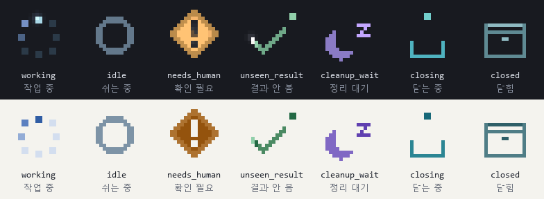

작업 중·대기·사용자 확인·미확인 결과·정리 대기·닫는 중·닫힘을 구분합니다. 색과 아이콘만으로 작업 성공을 추정하지 않고 피드 상태를 따릅니다.

탭의 마지막 패인이 열려 있어도 작업 수락과 결과 저장은 진행할 수 있습니다. 실제 정리는 제공자가 결과를 기록·보관한 뒤 수행하며, 가득 찬 진행률만으로 정리 완료를 뜻하지 않습니다. [수명주기 계약과 검증 기준](docs/task-lifecycle.md).

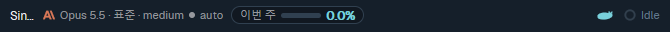

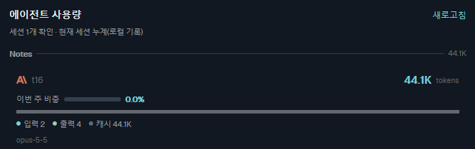

헤더는 에이전트 모델·상태와 세션 사용량을 표시합니다. 현재 Claude 할 일 수·서브에이전트 수는 연결된 Agent Usage 기록을 따르며 최대 2분 늦을 수 있습니다. 정지 캡처에 모든 동적 필드가 동시에 나오지는 않습니다.

### 도구 연결·리소스·플랜 한도

| 표시 | 화면 | 의미 |
| --- | --- | --- |
| CPU/RAM | 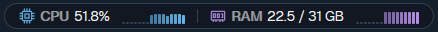 | 기기의 자원 사용량 |
| MCP | 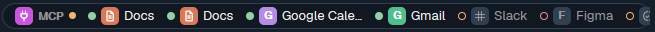 | 공급자가 보고한 도구 연결 상태 |
| CLI | 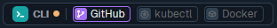 | CLI별 인증 상태 |
| 플랜 한도 | 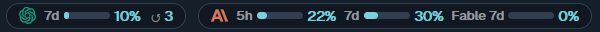 | 계정 한도이며 개별 에이전트 토큰 합계와 다름 |

Workspace Mods의 선택적 연동입니다. 이미지에 보이는 연결 서비스가 테마 설치만으로 자동 인증되는 것은 아닙니다.

### 프로젝트 문서

| 문서 찾기 | 문서 탭 |
| --- | --- |
| 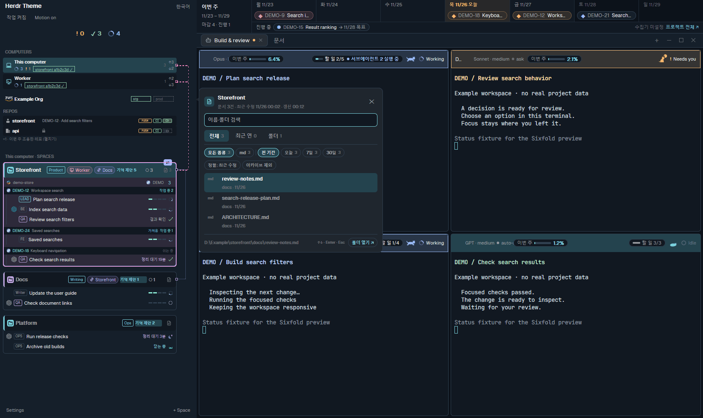 |  |

문서를 검색·고정하고 공간의 문서 탭 또는 선택적 파일 뷰어에서 읽습니다. [문서 검색·고정·탭 설정](docs/project-documents.md) · [파일 뷰어 설치](extras/preview/README.md).

### 이번 주 띠와 타임라인


터미널 위 띠는 이번 주 마감 이슈를 요일별로 보여 줍니다. 창은 이번 주를 프로젝트별로 묶고 기한 지남·오늘 마감·할 일을 표시합니다. 이슈 변경은 설정된 명령과 명시적 반영 절차를 사용합니다. [최신 동작과 설정](docs/week-timeline.md).

## 메시지 이펙트의 지원 범위

2026-11-12 확인 기준, 코어 [#90](https://github.com/herdrdev/herdr-core/pull/90)은 머지 없이 닫혔고 후속 [#167](https://github.com/herdrdev/herdr-core/pull/167)은 아직 열려 있습니다. 따라서 **일반 배포판 설치만으로 네이티브 메시지 이벤트가 있다고 가정하면 안 됩니다.**

- 후속 이벤트의 발신자는 `data.from`, 수신자는 이벤트의 `terminal`입니다. 앱의 `messageEvents()` 연결도 같은 형식에 맞아야 합니다.
- 이 이벤트는 명시적 send 입력 시도의 관측입니다. 읽음·업무 수락·완료는 별도의 근거가 필요합니다.
- 자동 실행의 첫 작업·키 입력·자동 부모 알림은 이 이벤트 대상이 아닙니다. 작업 배정은 선택적 작업 피드에서 별도로 표시합니다.
- 데모 화면은 합성 이벤트를 사용합니다. 실제 수집 경로, 원격 주소, 재연결과 발신자 미확인 처리는 설치 조합에서 따로 검증해야 합니다.

## 설치

Herdr 0.1.11 이상, 호환되는 herdr-core, Git, stable Rust와 C 컴파일러가 필요합니다. Windows 빌드는 MSVC C/C++ Build Tools 또는 완전한 GNU 호환 도구 체인이 필요합니다.

```sh
git clone https://github.com/chanyang721/herdr-theme.git
cd herdr-theme
cargo build --manifest-path rust/Cargo.toml --locked --release --bin herdr-theme --jobs 1
```

macOS / Linux:

```sh
./rust/target/release/herdr-theme install
herdr-app do layout.switch --name sixfold
```

Windows PowerShell:

```powershell
.\rust\target\release\herdr-theme.exe install
herdr-app do layout.switch --name sixfold
```

설치기는 `~/.config/herdr-app`에 테마와 고정 버전 Workspace Mods를 설치합니다(`HERDR_APP_HOME`으로 변경 가능). 다른 레이아웃과 설정을 보존하며 기존 설치를 임의로 덮어쓰지 않습니다. 이전 설치 갱신에는 `--update`를 사용하며, 직접 수정한 레이아웃과 팔레트는 유지됩니다. 작은 창에는 [Windows용 간결한 레이아웃](extras/windows-layout/README.md)을 참고하세요.

이후 변경은 검토한 소스를 빌드하고, 설치할 파일을 지정해 갱신합니다.

```sh
herdr-theme update-install mods/sixfold-desk/main.js mods/sixfold-desk/model.js
```

PATH에 없다면 빌드한 실행 파일의 경로를 사용하세요. 갱신기는 해당 모드를 검사하고 설치 파일을 백업한 뒤 앱 상태를 확인합니다. 앱이나 코어를 재시작하지 않습니다. [네이티브 도구와 갱신 상세](docs/native-rust-migration.md).

## 지원과 설정

사이드바와 모니터 스트립은 macOS와 Windows를 지원합니다. Linux는 네이티브 도구 경로가 있지만 데스크톱 UI는 검증하지 않았습니다. 음성과 HTML 스냅샷은 macOS 전용입니다. 메시지 애니메이션은 호환되는 앱·코어의 메시지 이벤트가 필요합니다. Agent Usage는 별도 설치한 [Insights](https://github.com/GaganSD/coding-agent-toolkit/tree/main/herdr-insights) 모드와 로컬 저장소가 필요합니다.

원격 연결, 에이전트 인증과 선택적 작업 피드 도구는 별도로 설정합니다. 테마는 작업 관리 서비스를 설치하지 않습니다. 개인 설정은 Git에서 제외되는 `*.local.json`에 저장하며, [site.example.json](config/site.example.json)에서 시작할 수 있습니다.

| 자세한 내용 | 안내 |
| --- | --- |
| 작업 피드·단계·상태 이미지 | [피드 규격](docs/panel-feed.md) · [네이티브 UI 갤러리](docs/panel-validation.md) |
| 문서 검색과 고정 | [프로젝트 문서](docs/project-documents.md) · [파일 뷰어](extras/preview/README.md) |
| 배지·질문 카드·보고 | [로컬 연동](docs/local-integrations.md) |
| 배치와 플랫폼별 옵션 | [모니터 스트립](extras/monitor-layout/README.md) · [Windows](extras/windows-layout/README.md) · [음성](voice/README.md) |

## 개발

```sh
npm test
cargo test --manifest-path rust/Cargo.toml --locked --jobs 1 -- --test-threads=1
```

클론마다 `sh scripts/install-git-hooks.sh`를 한 번 실행해 push 전 검사를 켜세요. 모드를 수정하면 `herdr-app check <mod-folder>`로 검사하고 실제 앱 화면도 확인합니다. [설계 개요](RECIPE.md) · [Apache-2.0](LICENSE).
