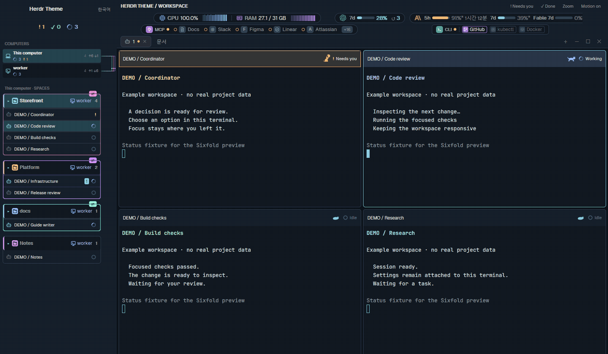
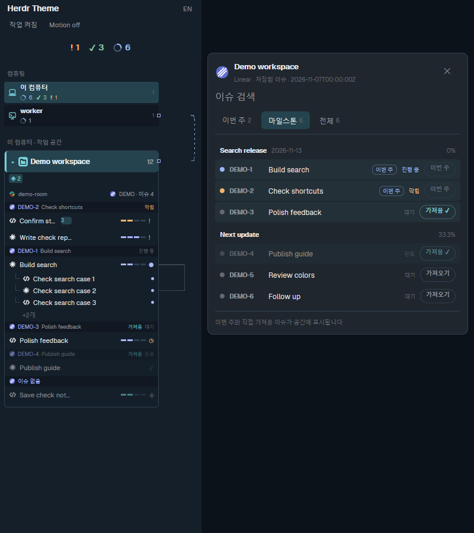
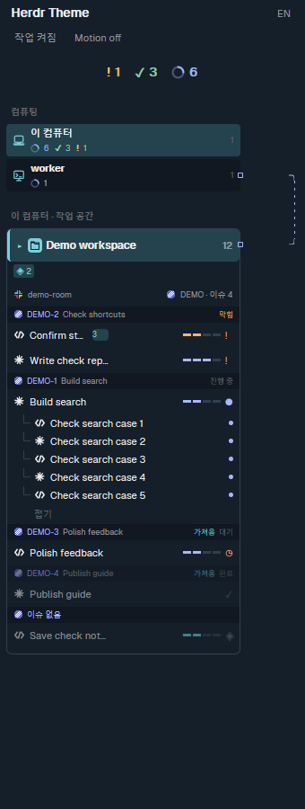
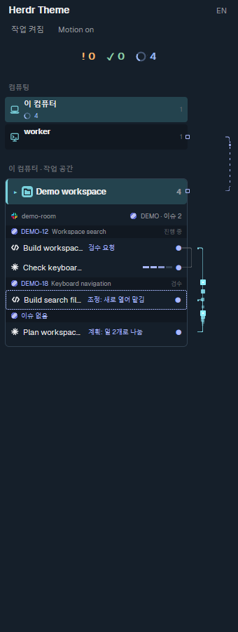
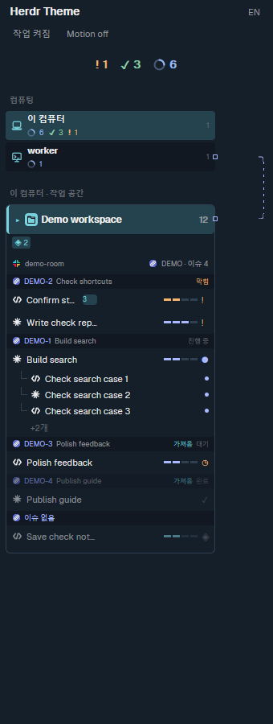
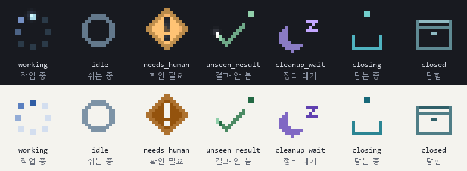
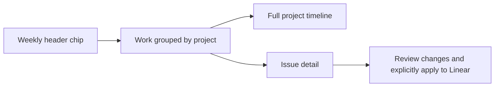

# Herdr Theme

A workspace sidebar and terminal layout for Herdr. Follow coding agents, shared projects and messages across computers, with tools and usage limits beside your terminals.

[한국어](README.ko.md)



A nine-step walkthrough assembled from native demo captures. Synthetic data; not a recording of a real end-to-end task. [Static first chapter](docs/media/workflow-poster.png).

## Features

- **Computers and workspaces:** per-computer agent counts, shared-project indicators, unread messages and animated message routes.
- **Tasks:** optional local feeds add task trees, progress stages, issue groups, review events and seven animated pixel-art states. The feed producer manages the work; the theme displays it.
- **Terminal headers:** agent state, model, effort and session usage, with an animated cat and a motion-off option. Claude panes also show task-list progress (`할 일 2/5`) and running sub-agents, read by Agent Usage from Claude's own records (refreshed every two minutes; hidden when no refresh came for six minutes).
- **Monitor strip:** CPU/RAM, MCP connections, CLI sign-in state, Claude/Codex plan limits and session tokens, supplied by the pinned [Workspace Mods](https://github.com/chanyang721/herdr-workspace-mods) release.
- **Documents:** workspace search, pins and a document tab; an optional file viewer previews Markdown beside your terminals.

## Walk through the workflow

The main GIF now covers **issue context → allocation → parallel work → messages → review request → verdict → acceptance → retained context → cleanup**, in nine chapters after a short animated overview, over about 46 seconds. Captions sit beside native captures; they are not new application UI.

This is an **editorial sequence of existing native screenshots with synthetic data**, not a continuous recording of a real task completing automatically. [Original native overview animation](docs/images/overview-native.gif) · [Source images and timings](docs/media/workflow-manifest.json) · [Full-window still](preview.png).

| 1. Select the issue | 2. Delegate and collaborate |
| --- | --- |
|  |  |
| Inspect week, milestone and all-issue scopes, including missing or stale cache states. | Follow parent/child tasks and their work titles. Allocation and file ownership belong to the external harness. |

| 3. Exchange messages and request review | 4. Preserve context and clean up |
| --- | --- |
|  |  |
| Allocation, messages, review requests, verdicts and acceptance are distinct events. A send is not a read receipt or task success. | Retention and closing stages come from the feed producer. The theme does not itself archive work or close agents. |

[Completed child rows removed](docs/images/panel-feed/children-completed-removed.png) · [Closed row removed](docs/images/panel-feed/closing-memory-4-hidden.png) · [Full event/state gallery](docs/panel-validation.md).

## Feature gallery

### Computers, shared projects and linked issues

| Dark | Light |
| --- | --- |
|  |  |

Select a computer and follow shared projects, supplied Slack/Linear/Jira data and issue-linked agents. Account connections require separate setup. [48 sharing/tool/Slack combinations](docs/panel-validation.md).

### Agent states and terminal headers



Working, idle, needs-human, unseen-result, cleanup-wait, closing and closed are separate states. An icon or a finished response does not independently prove successful work.

Task acceptance can advance while the last pane stays open. The producer must
record and archive the result before physical cleanup; a full task bar does not
prove that happened. [Lifecycle contract and verification matrix](docs/workflow-lifecycle.md).


Headers show model, state and session usage. Current Claude task-list and child-agent counts depend on Agent Usage records and may lag by two minutes. Not every dynamic field appears in the still capture at once.

### Tools, resources and plan limits

| Display | Native capture | Meaning |
| --- | --- | --- |
| CPU/RAM |  | Machine resource usage |
| MCP |  | Connections reported by the provider |
| CLI |  | CLI sign-in state |
| Plan limits |  | Account limits, not summed per-agent tokens |

These are optional Workspace Mods integrations. Services shown in a screenshot are not automatically authenticated by installing the theme.

### Project documents


Search and pin project documents, then use the document tab or optional file viewer. The capture shows the separate file viewer. [Search, pins and document tabs](docs/project-documents.md) · [Viewer setup](extras/preview/README.md).

### Weekly chip, timeline and issue detail

The current `week-timeline` opens from a header chip instead of occupying a permanent large strip. This is a **navigation diagram**, not a screenshot.



Dialogs float over the terminals. Issue edits use a configured command and explicit application step. [Current behavior and configuration](docs/week-timeline.md). A fresh native capture of this feature is not yet included in the gallery.

## Message animation compatibility

Checked on 2026-11-12: core [#90](https://github.com/herdrdev/herdr-core/pull/90) closed without merging; its successor [#167](https://github.com/herdrdev/herdr-core/pull/167) remains open. **Do not assume a standard release emits native message events.**

- The successor event uses `data.from` for the sender and the event envelope's `terminal` for the recipient. The app's `messageEvents()` adapter must match that shape.
- It observes an explicit send input attempt, not reading, task acceptance or completion.
- Automatic launch tasks, keys and automatic parent notes are excluded. Allocation has a separate optional harness-feed representation.
- The demo uses synthetic events. Verify the actual collector, remote addresses, reconnection and unknown-sender handling on the installed app/core pair.

## Install

Requires Herdr 0.1.11+, a compatible herdr-core, Git, stable Rust and a C compiler. Windows builds need MSVC C/C++ Build Tools or a complete GNU-compatible toolchain.

```sh
git clone https://github.com/chanyang721/herdr-theme.git
cd herdr-theme
cargo build --manifest-path rust/Cargo.toml --locked --release --bin herdr-theme --jobs 1
```

macOS / Linux:

```sh
./rust/target/release/herdr-theme install
herdr-app do layout.switch --name sixfold
```

Windows PowerShell:

```powershell
.\rust\target\release\herdr-theme.exe install
herdr-app do layout.switch --name sixfold
```

The installer adds the theme and pinned Workspace Mods under `~/.config/herdr-app` (`HERDR_APP_HOME` overrides it). It preserves other layouts and settings and refuses to overwrite an existing installation. Use `--update` to refresh a previous install while preserving edited layouts and palettes. See the [compact Windows layout](extras/windows-layout/README.md) for smaller windows.

For later changes, build the reviewed source and use the updater, listing the files to install:

```sh
herdr-theme update-install mods/sixfold-desk/main.js mods/sixfold-desk/model.js
```

Use the built executable's path if it is not on PATH. The updater checks affected mods, backs up installed files and verifies app health without restarting the app or core. [Native helper and update details](docs/native-rust-migration.md).

## Support and setup

The sidebar and monitor strip support macOS and Windows. Linux has native helper support; its desktop UI has not been verified. Voice and HTML snapshots require macOS. Message animations require compatible app/core message events. Agent Usage needs the separately installed [Insights](https://github.com/GaganSD/coding-agent-toolkit/tree/main/herdr-insights) mod and its local store.

Remote connections, agent credentials and optional task producers are configured separately. No task service is installed with the theme. Local customizations belong in git-ignored `*.local.json` files; start with [site.example.json](config/site.example.json).

| More detail | Guide |
| --- | --- |
| Tasks, stages and state images | [Feed contract](docs/panel-feed.md) · [Native UI gallery](docs/panel-validation.md) |
| Documents, search and pins | [Project documents](docs/project-documents.md) · [File viewer](extras/preview/README.md) |
| Badges, question cards and reports | [Local integrations](docs/local-integrations.md) |
| Layout and platform options | [Monitor strip](extras/monitor-layout/README.md) · [Windows](extras/windows-layout/README.md) · [Voice](voice/README.md) |

## Development

```sh
npm test
cargo test --manifest-path rust/Cargo.toml --locked --jobs 1 -- --test-threads=1
```

Run `sh scripts/install-git-hooks.sh` once per clone to enable pre-push checks. Validate changed mods with `herdr-app check <mod-folder>` and inspect them in the app. [Design brief](RECIPE.md) · [Apache-2.0](LICENSE).
