# Herdr Theme

A workspace sidebar and terminal layout for Herdr. Follow coding agents, shared projects and messages across computers, with tools and usage limits beside your terminals.

[한국어](README.ko.md)

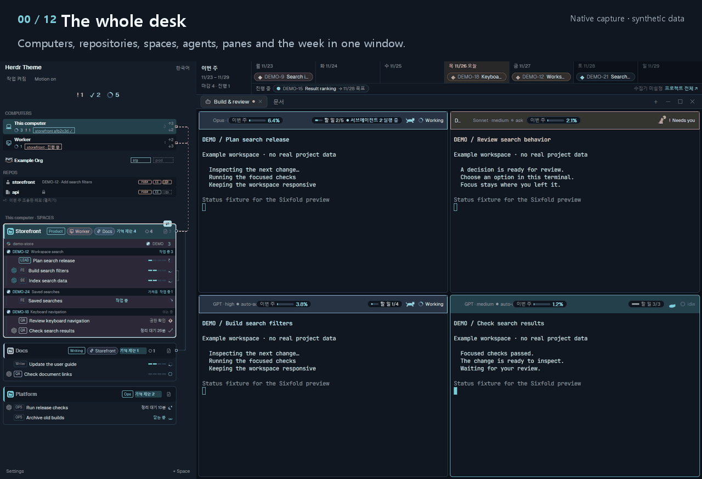

Twelve scenes in native captures of an isolated demo with synthetic data. Not a recording of a real task. [Static first frame](docs/media/workflow-poster.png).

## Features

- **Computers and spaces:** per-computer agent counts, install chips showing which commit each computer runs, shared-project and role-group chips, per-space alerts, and message routes (solid on one computer, dashed across computers).
- **Repositories:** a REPOS row per repository with PUSH, CI and CD stages and deployment targets, from an optional `repo_flow` feed.
- **Tasks:** optional local feeds add issue groups, job chips (`LEAD`, `FE`, `QA` …), stage bars, seven agent states, assignment and review events, and cleanup steps with a memory-proposal badge. The feed producer manages the work; the theme displays it. Explicit wait reasons share the existing progress slot in each single-line row; hover for the full reason.
- **Issues:** an issue popover with week, milestone, all and alerts tabs. With a command configured in `data/sixfold/issue-start.json`, **작업 시작** in the issue detail starts the issue with the chosen agent and level and shows where it went.
- **Requests:** permission, question and plan cards wait in a tab beside the space that asked; a request from another space opens by itself.
- **Terminal headers:** agent state, model, effort and session usage, with an animated cat and a motion-off option. Claude panes also show task-list progress (`할 일 2/5`) and running sub-agents, read by Agent Usage from Claude's own records (refreshed every two minutes; hidden when no refresh came for six minutes).
- **Monitor strip:** CPU/RAM, MCP connections, CLI sign-in state, Claude/Codex plan limits and session tokens, supplied by the pinned [Workspace Mods](https://github.com/chanyang721/herdr-workspace-mods) release.
- **Documents:** a finder for each space's documents, pins and a **문서** tab per space; an optional file viewer previews Markdown beside your terminals.
- **This week:** a band above the terminals lists due issues by day; a timeline dialog groups the week by project.

## Walk through the workflow

The GIF shows an overview and twelve scenes in 39 frames, about 64 seconds. Each frame is one native capture of the isolated demo app, scaled down. The caption bar and the outline are documentation; the screen inside is unchanged. The demo's events, alerts and requests were written by hand into local feed files, so this is **not a recording of a real task running end to end**. [Sources, outlined regions and timings](docs/media/workflow-manifest.json) · [How the captures were made](docs/media/README.md).

| 1. Start from an issue | 2. Split and hand out the work |
| --- | --- |
| 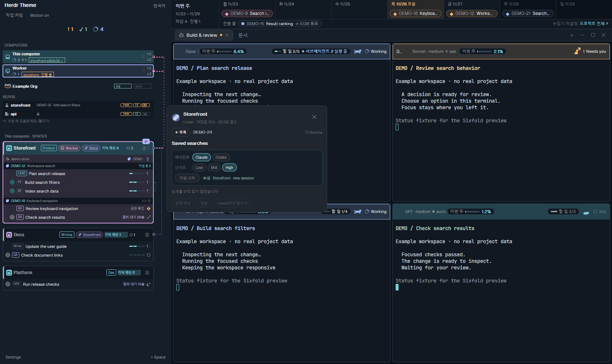 | 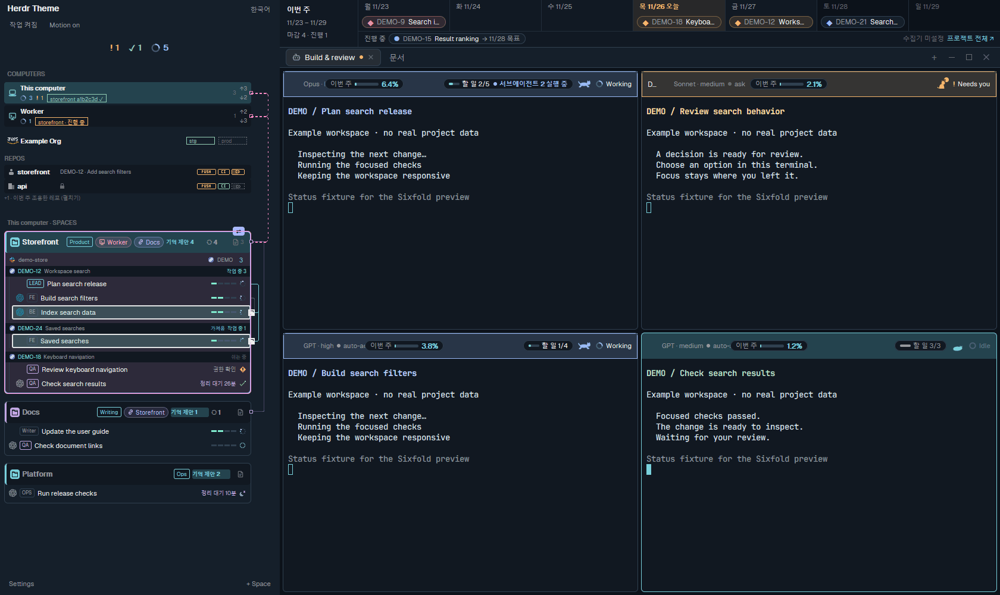 |
| Choose an agent and a level, press 작업 시작. The line beside it says where the work went. | A spawn adds a placeholder row under its issue; an assignment labels the lead's row. Chips show each job. |

| 3. Stages and states | 4. Messages |
| --- | --- |
| 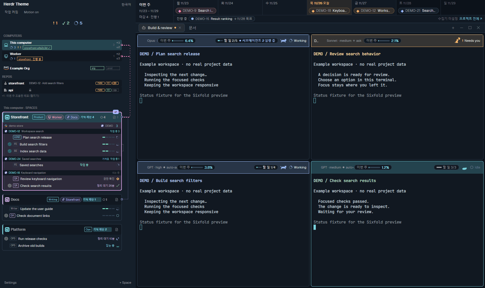 |  |
| Each row has a stage bar and a state mark. A closed row shows 닫힘 before it leaves (scene 9). | Solid lines join spaces on this computer; dashed lines cross to another computer. |

| 5. Alerts per space | 6. Requests beside the card |
| --- | --- |
| 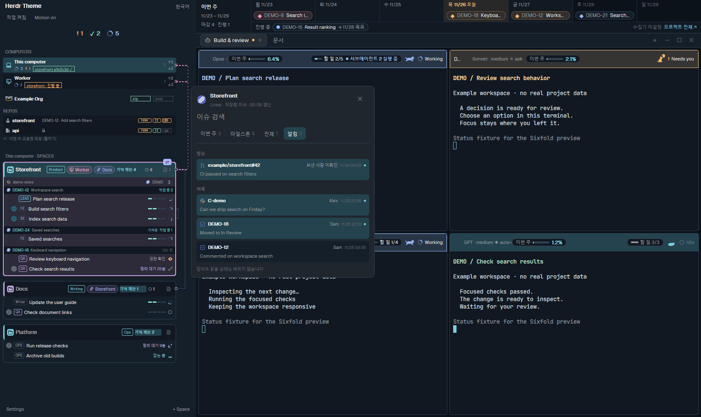 | 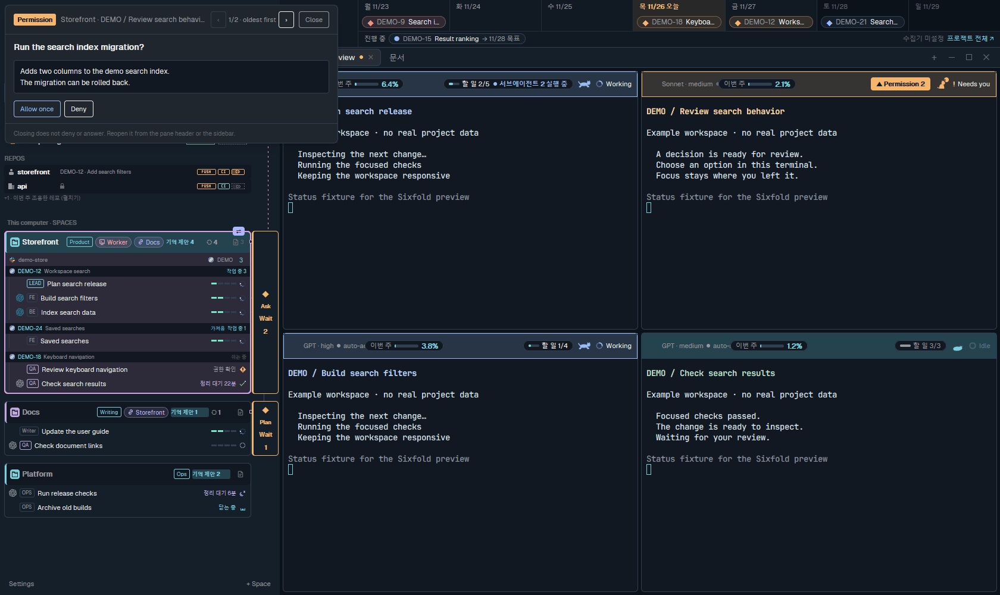 |
| Slack, Linear and GitHub alerts stay with their space, grouped by time. | The tab beside a space opens its requests, oldest first. |

| 7. Review, verdict, acceptance | 8. Push, CI and deploy |
| --- | --- |
|  | 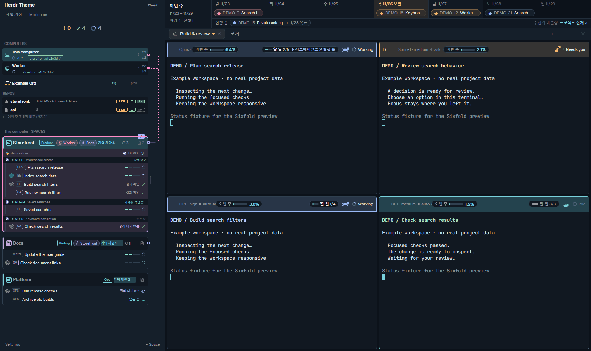 |
| A review request, the verdict and the owner's acceptance are three separate events. | REPOS shows each stage; install chips show which computer runs which commit. |

| 9. Cleanup and memory | 10. Pane headers |
| --- | --- |
|  |  |
| A finished row reports, saves its decisions, proposes memory and closes. The space's 기억 제안 badge counts proposals. | Model, effort, permission, weekly usage, to-dos and running subagents per pane. |

| 11. Documents | 12. This week |
| --- | --- |
| 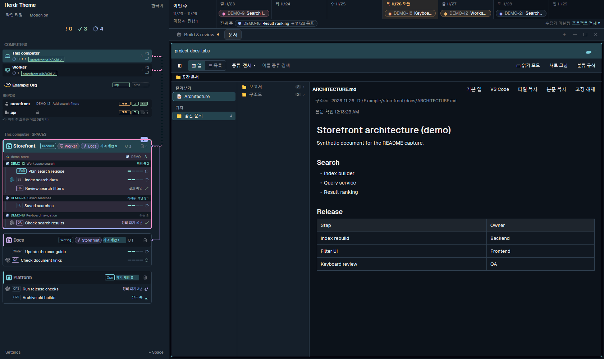 | 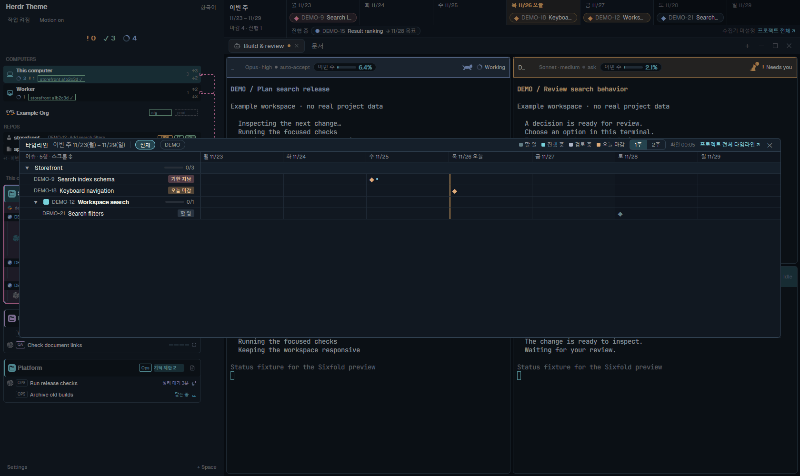 |
| Search a space's documents or browse them in its 문서 tab. [Finder](docs/images/walkthrough/docs-finder.png). | The band lists due issues by day; the dialog groups the week by project. |

What the demo does not show:

- The issue detail body says it has not been read yet: the demo has no issue-detail reader.
- The week band says 수집기 미설정: the demo has no timeline collector and reads a prepared week file.
- The monitor strip is not part of this layout. Its captures are in the gallery below.
- Messages and other events come from the demo feed, not from the core's send events. See [message animation compatibility](#message-animation-compatibility).

[Older event and state gallery](docs/panel-validation.md).

## Feature gallery

### Computers, shared projects and linked issues

| Dark | Light |
| --- | --- |
| 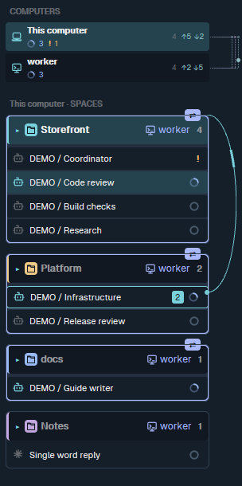 | 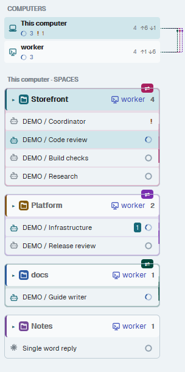 |

Select a computer and follow shared projects, supplied Slack/Linear/Jira data and issue-linked agents. Account connections require separate setup. [48 sharing/tool/Slack combinations](docs/panel-validation.md).

### Repositories and deployments

| Before | After |
| --- | --- |
|  |  |

Each repository row shows PUSH, CI and CD. A company repository shows its provider and its stage and production targets. Install chips under each computer name the commit it runs or say it is still deploying. The data comes from an optional producer. [Repository stages in the feed](docs/panel-feed.md#optional-space-notifications-pending-requests-and-repository-stages).

### Alerts and requests

| A request from another space | Alerts of one space |
| --- | --- |
| 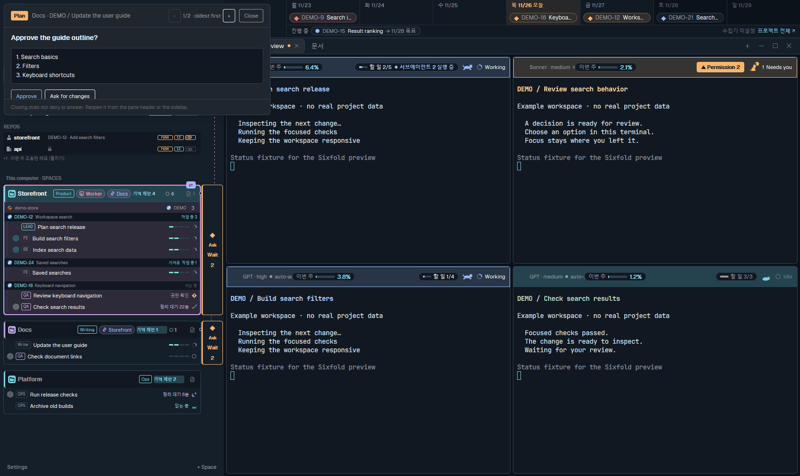 |  |

Requests come from a configured card bridge. Closing the popup does not answer or deny it; reopen it from the tab or the pane header. [Cards and a configured command](docs/local-integrations.md#cards-and-a-configured-command).

### Agent states and terminal headers

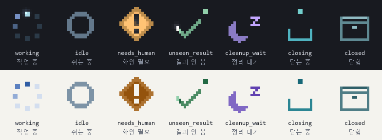

Working, idle, needs-human, unseen-result, cleanup-wait, closing and closed are separate states. An icon or a finished response does not independently prove successful work.

Task acceptance can advance while the last pane stays open. The producer must
record and archive the result before physical cleanup; a full task bar does not
prove that happened. [Lifecycle contract and verification matrix](docs/task-lifecycle.md).

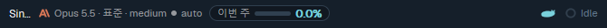

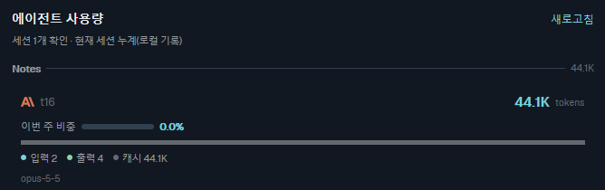

Headers show model, state and session usage. Current Claude task-list and child-agent counts depend on Agent Usage records and may lag by two minutes. Not every dynamic field appears in the still capture at once.

### Tools, resources and plan limits

| Display | Native capture | Meaning |
| --- | --- | --- |
| CPU/RAM | 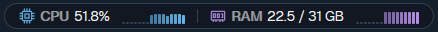 | Machine resource usage |
| MCP | 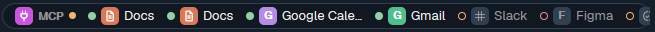 | Connections reported by the provider |
| CLI |  | CLI sign-in state |
| Plan limits | 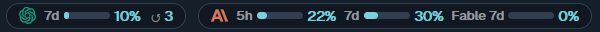 | Account limits, not summed per-agent tokens |

These are optional Workspace Mods integrations. Services shown in a screenshot are not automatically authenticated by installing the theme.

### Project documents

| Finder | 문서 tab |
| --- | --- |
| 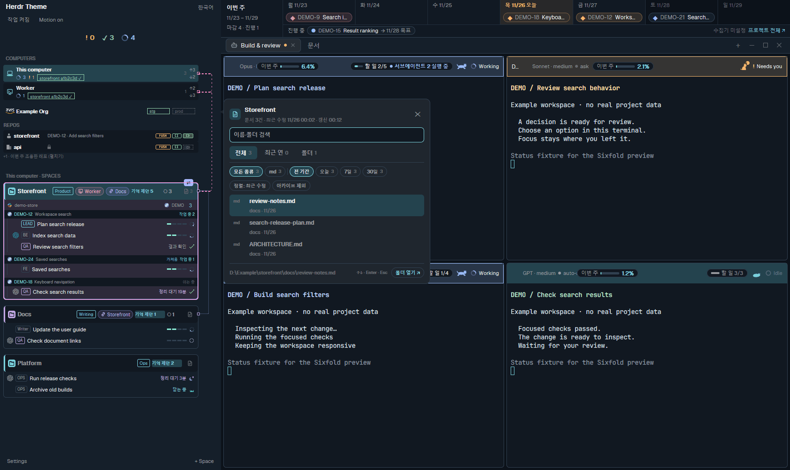 |  |

Search and pin project documents, then read them in the space's 문서 tab or the optional file viewer. [Search, pins and document tabs](docs/project-documents.md) · [Viewer setup](extras/preview/README.md).

### Weekly band and timeline


The band above the terminals lists this week's due issues by day. The dialog groups the week by project, with overdue, due-today and to-do marks. Issue edits use a configured command and an explicit apply step. [Current behavior and configuration](docs/week-timeline.md).

## Message animation compatibility

Checked on 2026-11-12: core [#90](https://github.com/herdrdev/herdr-core/pull/90) closed without merging; its successor [#167](https://github.com/herdrdev/herdr-core/pull/167) remains open. **Do not assume a standard release emits native message events.**

- The successor event uses `data.from` for the sender and the event envelope's `terminal` for the recipient. The app's `messageEvents()` adapter must match that shape.
- It observes an explicit send input attempt, not reading, task acceptance or completion.
- Automatic launch tasks, keys and automatic parent notes are excluded. Allocation has a separate optional task-feed representation.
- The demo uses synthetic events. Verify the actual collector, remote addresses, reconnection and unknown-sender handling on the installed app/core pair.

## Install

Requires Herdr 0.1.11+, a compatible herdr-core, Git, stable Rust and a C compiler. Windows builds need MSVC C/C++ Build Tools or a complete GNU-compatible toolchain.

```sh
git clone https://github.com/chanyang721/herdr-theme.git
cd herdr-theme
cargo build --manifest-path rust/Cargo.toml --locked --release --bin herdr-theme --jobs 1
```

macOS / Linux:

```sh
./rust/target/release/herdr-theme install
herdr-app do layout.switch --name sixfold
```

Windows PowerShell:

```powershell
.\rust\target\release\herdr-theme.exe install
herdr-app do layout.switch --name sixfold
```

The installer adds the theme and pinned Workspace Mods under `~/.config/herdr-app` (`HERDR_APP_HOME` overrides it). It preserves other layouts and settings and refuses to overwrite an existing installation. Use `--update` to refresh a previous install while preserving edited layouts and palettes. See the [compact Windows layout](extras/windows-layout/README.md) for smaller windows.

For later changes, build the reviewed source and use the updater, listing the files to install:

```sh
herdr-theme update-install mods/sixfold-desk/main.js mods/sixfold-desk/model.js
```

Use the built executable's path if it is not on PATH. The updater checks affected mods, backs up installed files and verifies app health without restarting the app or core. [Native helper and update details](docs/native-rust-migration.md).

## Support and setup

The sidebar and monitor strip support macOS and Windows. Linux has native helper support; its desktop UI has not been verified. Voice and HTML snapshots require macOS. Message animations require compatible app/core message events. Agent Usage needs the separately installed [Insights](https://github.com/GaganSD/coding-agent-toolkit/tree/main/herdr-insights) mod and its local store.

Remote connections, agent credentials and optional task producers are configured separately. No task service is installed with the theme. Local customizations belong in git-ignored `*.local.json` files; start with [site.example.json](config/site.example.json).

| More detail | Guide |
| --- | --- |
| Tasks, stages and state images | [Feed contract](docs/panel-feed.md) · [Native UI gallery](docs/panel-validation.md) |
| Documents, search and pins | [Project documents](docs/project-documents.md) · [File viewer](extras/preview/README.md) |
| Badges, question cards and reports | [Local integrations](docs/local-integrations.md) |
| Layout and platform options | [Monitor strip](extras/monitor-layout/README.md) · [Windows](extras/windows-layout/README.md) · [Voice](voice/README.md) |

## Development

```sh
npm test
cargo test --manifest-path rust/Cargo.toml --locked --jobs 1 -- --test-threads=1
```

Run `sh scripts/install-git-hooks.sh` once per clone to enable pre-push checks. Validate changed mods with `herdr-app check <mod-folder>` and inspect them in the app. [Design brief](RECIPE.md) · [Apache-2.0](LICENSE).
