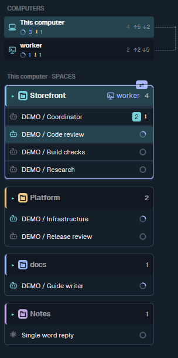
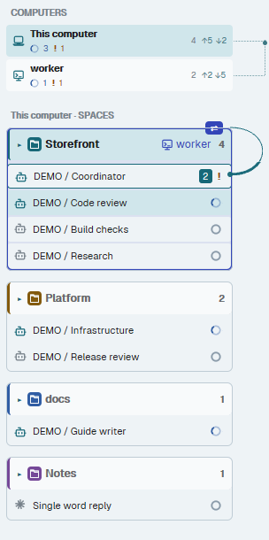
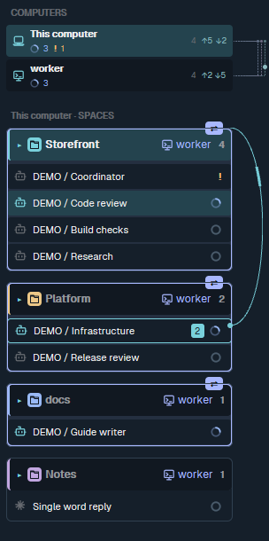
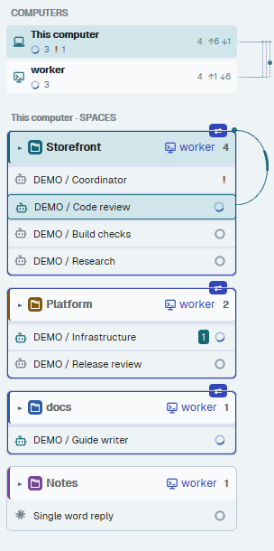
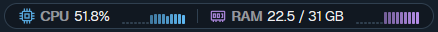
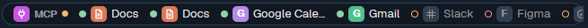
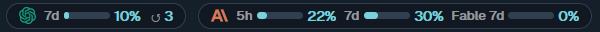
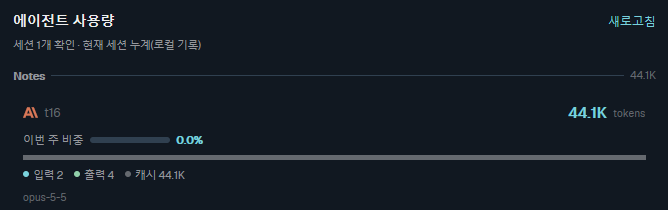
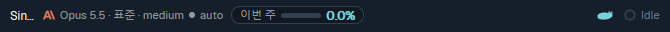
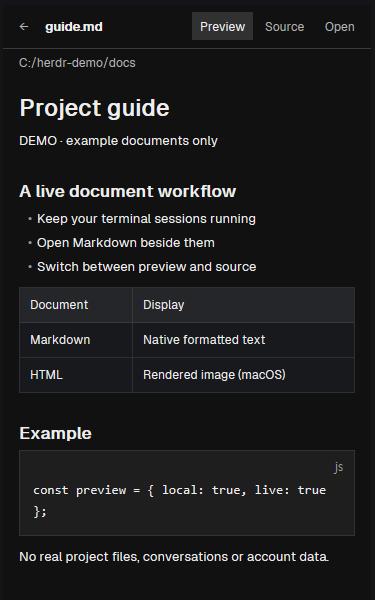

# Herdr Theme

Coordinate coding agents across projects and computers from one live sidebar. See every workspace and agent, follow concurrent messages (including sends between computers), see which projects are being worked on from more than one computer, and keep CPU/RAM, MCP connections, account CLIs, plan limits and per-session token use in view — without leaving your current terminal.


[한국어](README.ko.md)

The screenshots are of the real app on Windows 11 (Herdr app 0.1.12, core 0.1.17) with labelled demo workspaces; the second computer, "worker", is synthetic. The monitor strip shows this machine's real readings.

## What you get

Herdr Theme is the layout and sidebar. The installer also adds [Herdr Workspace Mods](https://github.com/chanyang721/herdr-workspace-mods) at a pinned release, so the monitor strip works out of the box. Both repositories stay separate; this README covers them together.

| Part | What it shows |
| --- | --- |
| Sidebar (this repo) | Computers with per-computer status, workspaces and their agents, unread messages, animated sends, shared work across computers, subagent trees |
| [System Metrics](#system-metrics) | CPU and RAM with recent-sample bars |
| [MCP Status](#mcp-status) | Each MCP server's connection, Claude and Codex merged |
| [CLI Status](#cli-status) | Sign-in state of AWS profiles, GitHub, kubectl and Docker |
| [Plan Usage](#plan-usage) | Codex and Claude 5h / 7d limits, Codex limit resets |
| [Agent Usage](#agent-usage) | Token use of each live Claude/Codex session; the session's model and weekly share in its pane header |
| [Document Viewer](#document-viewer) (optional) | Project files and Markdown beside your terminals |

## Platform support

Checked on Windows 11 on 2026-11-04 by running each part; macOS is where the theme was built.

| Part | macOS | Windows |
| --- | --- | --- |
| Sidebar, computers, message flow, shared-work display | yes | yes |
| System Metrics, MCP Status, CLI Status, Plan Usage, Agent Usage | yes | yes |
| Workflow collector (subagent trees) | yes | yes (Task Scheduler snippet below) |
| Document Viewer: Markdown | yes | yes |
| Document Viewer: HTML preview | yes (WebKit snapshot) | no — HTML opens on its source; the HTML tab says the preview needs macOS |
| Document Viewer: refresh when a file is saved | yes | yes |
| Voice | yes | no (the installer skips it) |
| Live TUI bridge | yes (also Linux) | no (needs `termios`) |
| Idle-session sleep and finished-workspace cleanup | yes (LaunchAgents) | no |

Linux follows the macOS column except where noted, but was not checked for this release.

## Requirements

- Herdr app 0.1.11 or newer, Python 3 and Git. Computer lists and remote workspaces need machine-layout support (checked on 0.1.17).
- Message animations need the native message events: an app exposing `messageEvents()` and a core emitting `message_sent`. Until they ship in a release, build both from source: the app from the [`feat/message-sent-events`](https://github.com/chanyang721/herdr-app/tree/feat/message-sent-events) branch and the core from [herdrdev/herdr-core#90](https://github.com/herdrdev/herdr-core/pull/90). Install the app and core together, and replace the core on every computer whose sends you want to see (the core that delivers a message emits the event). Without them everything else works; sends do not animate.
- Agent Usage reads the local store of the [Insights](https://github.com/GaganSD/coding-agent-toolkit/tree/main/herdr-insights) mod (install it separately; it needs Node.js).

## Install

macOS / Linux:

```sh
git clone https://github.com/chanyang721/herdr-theme.git
cd herdr-theme
python3 scripts/install.py
herdr-app do layout.switch --name sixfold
```

Windows (PowerShell, with the Python launcher):

```powershell
git clone https://github.com/chanyang721/herdr-theme.git
cd herdr-theme
py -3 scripts/install.py
herdr-app do layout.switch --name sixfold
```

The installer:

- installs the theme's mods, layouts, palettes and helper scripts into the app home (`~/.config/herdr-app` on every platform; `HERDR_APP_HOME` overrides it);
- fetches Herdr Workspace Mods at the commit pinned in [`workspace-mods.lock.json`](workspace-mods.lock.json) into `~/.local/share/herdr-sixfold/vendor/herdr-workspace-mods/<commit prefix>` (one folder per commit, made only once the checkout succeeds), checks it is exactly that commit with no local changes, and installs the files that commit tracks for `system-metrics`, `mcp-status`, `cli-status`, `plan-usage` and `agent-usage` with the theme. The installed release is recorded in `data/sixfold/workspace-mods.json`;
- runs the Document Viewer's own installer when a layout with a Files panel exists (Herdr creates `main` on first start); otherwise it prints that command to run later. Off macOS it installs Markdown only;
- refuses to replace existing files or an existing `layout:sixfold` key section, and preserves other layouts, settings and key bindings. `--update` refreshes what it installed before and keeps layouts and palettes you changed.

Options: `--without-workspace-mods` installs the theme alone (the `sixfold` layout's monitor strip then needs those mods installed some other way); `--workspace-mods-source PATH` installs from a local checkout already at the pinned commit instead of fetching. On a wide screen the `sixfold` layout puts the whole strip in one row; on a smaller Windows window use the two-row variant in [`extras/windows-layout`](extras/windows-layout/README.md), which the screenshots use.

### Updating an installation

After the first install, **use only `scripts/update_install.py`; never copy files into the running app by hand.** List the theme files you reviewed; the pinned Workspace Mods are brought to the pinned release in the same run (unchanged files are skipped, so nothing reloads needlessly):

```sh
python3 scripts/update_install.py mods/sixfold-desk/main.js mods/sixfold-desk/model.js
python3 scripts/update_install.py            # only bring the Workspace Mods to the pinned release
```

(`py -3` on Windows.) `--without-workspace-mods` leaves them as installed; a run that lists only `voice` never touches them.

The updater locks `data/sixfold/install.lock`, builds complete affected mod trees outside `mods/`, runs `herdr-app check` on each, keeps full backups under `backups/sixfold-update-*/`, then exchanges each mod directory. On macOS and Linux the exchange is atomic; Windows has no directory swap, so the mod path is missing for a moment and a failed move puts the installed tree back. It then requires `status.errors` to stay empty for one second with space, tab and focus unchanged, and rolls back otherwise (a later concurrent writer is preserved and reported). The receipt in the backup records what happened. A clean status is not a visual check: also look at `herdr-app shot`.

Install several files in one run rather than one at a time: each swap reloads a mod, and a burst of reloads can exhaust the app. Use a separate git worktree per editing session, and let one session install a reviewed candidate. **Never duplicate an installed mod into `mods/*-recovery`.** `--allow-unhealthy-before` permits initial errors for an authorized repair (final errors must still be zero); `--verify-timeout 30` gives hot reload more time. The updater never quits or restarts Herdr or herdr-core. When running the installed copy in `scripts/sixfold/`, pass `--repo /path/to/reviewed-worktree`.

## Keys

These bindings apply only while the `sixfold` layout is selected; other Herdr bindings stay available.

| Key (macOS) | Action |
| --- | --- |
| Cmd+[ / Cmd+] | Previous / next pane in the current tab |
| Cmd+Option+1…6 | Focus a numbered pane |
| Ctrl+Shift+arrows | Focus a neighbour |
| Cmd+Shift+Up / Down | Previous / next workspace |
| Cmd+Shift+J / U | Next blocked / completed agent |
| Ctrl+Shift+N | New workspace on the selected computer |
| Cmd+R | Rename tab |
| Cmd+X | Close the app pane |
| Cmd+W / Cmd+Shift+W | Intentionally do nothing, to avoid accidental closure |

On Windows and Linux, adjust the layout-scoped fragment in `keys.json` to your keyboard.

## Computers and remote agents

The sidebar lists this computer and persistent `hc machine` connections. Selecting a computer shows only its workspaces and agents, with its attention counts and next-blocked/next-done navigation; switching back returns to its last workspace. The list follows focus: moving focus to a session on another computer switches to that computer, and a manual pick holds until focus moves again. Selecting a computer never moves terminal focus or starts a connection.

Each computer row shows its working / done / needs-you counts (only non-zero ones; the tooltip has all of them) and ↑N ↓N, the sends to and from other computers in the **last ten minutes**.

Local and connected/connecting computers are shown by default. Disconnected remotes and unregistered Tailscale peers are hidden until you expand the list with the arrow beside **COMPUTERS**. **+ Space** and **Ctrl+Shift+N** target the selected computer: locally a 3×2 split of four Claude and two Codex sessions, remotely one terminal in that computer's home (or its configured folder).

From the main computer, `hc send worker/t7 "message"` sends to that computer's terminal (use the qualified address from `hc ls`). A successful send is not a read receipt. The theme does not configure SSH, Tailscale, firewall rules or agent credentials.

### Shared work across computers

Workspaces belong to the same project when their names match; a trailing `(computer name)` naming the workspace's own computer is ignored, so `Docs (worker)` on `worker` matches `Docs` here. Unnamed workspaces (`~`) are skipped.

- **A partner is always visible:** whenever that project has a workspace on another computer, its header shows a 14px computer icon and the partner's name at 12px, even with no work in progress. With more partners it reads, for example, `worker +1`; the tooltip lists every partner and its working-agent count. The collaboration colour is periwinkle: `#A9B8FF` on dark themes, `#3346B8` on light themes, adjusted for at least 4.5:1 text contrast on the header (win98 uses `#3043AF`).
- **Working together now:** when this computer and at least one partner both have working agents on the project, the workspace gets a **2px solid outline, a 10% tint and a filled ⇄ badge** on its top edge. `⇄2`, `⇄3` … count the other computers working on it. These are overlays, so the layout stays still. When shared work ends, the workspace returns to its usual appearance with the partner name still visible; the badge fades with motion on.
- **Find the other side:** hover a workspace to outline and tint its partner computer rows; hover a computer row to highlight its partner workspaces. Workspace partner names and shared-work marks are independent of the computer-list pipes' four-link limit. Orange needs-you / approval-waiting marks remain visible.

The computer list separately draws up to four right-angle dashed pipes in a fixed right margin: for shared work, or for a pair of computers for **five minutes after their last send**. The ↑/↓ counts still cover the **last ten minutes**. A shared-work mark shows simultaneous activity on the same project; a send link shows a send event. Neither proves that a particular message was delivered or read.

| One shared project · dark | One shared project · light |
| --- | --- |
|  |  |

| Multiple project groups · dark | Multiple project groups · light |
| --- | --- |
|  |  |

Native app captures on Windows 11, using `sixfold-night` / `sixfold-day` and demo workspaces. Only the `worker` computer and its sidebar data (including send events) are synthetic. In the multiple-group views, Notes has a partner but no shared work in progress, so its header keeps the partner name without an active border or badge.

### Sends between computers

A send whose ends are on different computers runs its pipe from the visible row up to the top of the workspace list. The other computer's row lights up in the route colour with ⇡ (sent) or ⇣ (received), and the footer adds a ⇄ chip naming the far computer. An endpoint's computer comes from its terminal address (`machine/` prefix), so background remote terminals count too.

### Names, folders and discovery

Friendly names and default folders live only in `~/.config/herdr-app/data/sixfold/computers.local.json`:

```json
{
  "local": { "label": "Home" },
  "machines": {
    "worker": { "label": "Build computer", "folder": "/home/user/projects" }
  }
}
```

Keys match `hc machine ls`. Without the file, native names are shown (this computer reads "This computer", "This Mac" on macOS). `"tailscale": true` in the same file lists Tailscale peers from the local `tailscale status --json` every 15 seconds; those rows are passive and "online" does not mean SSH or Herdr is reachable. Registering a remote needs a noninteractive SSH connection (or a byte-preserving `--via` command) and a compatible `hc` there; for a Windows target enable OpenSSH Server, key authentication and a TCP 22 rule scoped to your Tailscale address, then `hc machine add user@TAILSCALE_IP --name HOST`.

## Message flow

There is no permanent message panel. A new send shows a sender → recipient notice for about four seconds; colours and lanes separate concurrent routes, and repeated sends keep their own packets with a grouped count. Unresolved queued/error/held deliveries stay in a compact footer row until resolved. Motion off disables travel.

The sidebar reads sends from the app's in-memory `messageEvents()` (see [Requirements](#requirements)); events carry sender, recipient, time and the observed `started` result, never message text. Send with the core CLI directly: `hc send TARGET "message"`.

**Removing the old tracing launcher.** Earlier versions shipped a Python launcher; it has been removed. If you installed it, remove `~/.local/share/herdr-sixfold/bin` from your PATH, stop calling `hc_trace.py`, check that `hc` resolves to the core CLI (`Get-Command hc -All` / `command -v hc`), restore a `~/.local/bin/hc` symlink that points at the launcher, delete `hc_trace.py`, `bin/hc` and `bin/hc.cmd` under `~/.local/share/herdr-sixfold/`, and update installed `route.py` and `collect_workflow.py`.

## Subagent trees and the workflow collector

Subagents expand under their parent with `▸ N`; new delegations open the tree and animate a pipeline. `scripts/collect_workflow.py` reads Claude metadata, the read-only Codex database and hc parent links into `data/sixfold/workflow.json` (`--once`, or every three seconds writing only changes). It runs on macOS, Linux and Windows (on Windows without opening console windows).

The first install does not include the collector and nothing registers it to run in the background. Install it with the updater (`python3 scripts/update_install.py scripts/collect_workflow.py`, `py -3` on Windows). On Windows you can run it at logon, hidden, one instance at a time:

```powershell
$pyw = Join-Path (Split-Path (py -3 -c "import sys; print(sys.executable)")) 'pythonw.exe'
$home_ = "$HOME\.config\herdr-app"
$action = New-ScheduledTaskAction -Execute $pyw -Argument "`"$home_\scripts\sixfold\collect_workflow.py`"" -WorkingDirectory $home_
$trigger = New-ScheduledTaskTrigger -AtLogOn -User $env:USERNAME
$settings = New-ScheduledTaskSettingsSet -MultipleInstances IgnoreNew -ExecutionTimeLimit 0 -AllowStartIfOnBatteries -DontStopIfGoingOnBatteries
Register-ScheduledTask -TaskName 'Herdr Theme workflow collector' -Action $action -Trigger $trigger -Settings $settings
Start-ScheduledTask -TaskName 'Herdr Theme workflow collector'
```

Remove it with `Stop-ScheduledTask` and then `Unregister-ScheduledTask -TaskName 'Herdr Theme workflow collector' -Confirm:$false`.

## Workspace Mods

These come from [Herdr Workspace Mods](https://github.com/chanyang721/herdr-workspace-mods) and are installed with the theme; each also works on its own (see that repository). The strip's helpers are Python scripts started by the mods; on Windows they run without console windows, and click-to-copy uses `Set-Clipboard` (macOS `pbcopy`, Linux `wl-copy`/`xclip`). Labels in the strip are Korean.

### System Metrics



CPU and RAM of the computer the sidebar shows, with a bar of recent samples, refreshed every few seconds. A remote computer is read through `hc` on that machine. An unavailable reading shows as unavailable, never as zero.

### MCP Status



One chip per MCP server from `claude mcp list` (and `codex mcp list`, merged by name): a state dot, a service-colour badge and a short name. Green = connected; an orange ring = needs sign-in or approval; red = failed; grey = unknown. It checks every three minutes, and again after 30 s, 1, 2 and 5 minutes when a server drops; the tooltip says when it dropped and recovered and how many running Claude sessions may need `/mcp`. Clicking a chip copies the sign-in step (`/mcp` or `codex mcp login <name>`) and never signs in by itself. Rename, re-icon or hide servers in `data/sixfold/mcp-status.local.json`. When the block is too narrow for every server, it shows those that fit — servers needing attention first — and counts the rest on a `+N` chip whose tooltip names them.

### CLI Status


Square tags for AWS profiles (one per profile, when the AWS CLI is installed), GitHub (`gh auth status`, account count per host), the kubectl context (no cluster connection is made) and the Docker daemon. Coloured when signed in or running, greyscale when expired, missing or stopped. Checks every four minutes, with the same drop rechecks; a click copies the login command. No tokens, user names or full account IDs are kept. Choose what to show in `data/sixfold/cli-status.local.json`.

### Plan Usage



Codex and Claude limits as brand icons, bars and percentages: 5-hour and 7-day windows, model-scoped weekly windows when the provider reports them (`Fable 7d`), and `↺ N`, the Codex limit resets left, with a confirm-first button to use one. A Codex workspace that ran out of credits or hit its spend limit is shown even when the personal windows read low. Limits refresh every two minutes; when the provider rate-limits the check, the pill shows an error until the next successful read.

### Agent Usage



Token use of each live Claude/Codex session the core reports, grouped by workspace: the session total, uncached input / output / cache, this week's share and the model. A session is matched to its terminal on Windows through `~/.claude/sessions/<pid>.json` (Claude) or the rollout file its process holds open (Codex); an unmatched session shows `—`, not zero. It needs the Insights store (refreshed at most every five minutes) and lives in a layout pane, not an overlay. The theme's pane headers show the same session's model, speed, effort, permission mode and weekly share:



### Document Viewer



A project file tree and a preview panel for Markdown (and on macOS images, PDFs and local HTML as a read-only WebKit snapshot), with Source and Open. It installs into a layout with a Files panel and fetches its reviewed upstream (Preview Plus / Files Plus) at a pinned commit. On Windows HTML opens on its source, and its HTML tab says the preview needs the macOS renderer; Markdown preview and save-to-refresh work.

## More of the sidebar

**Workspace badges.** Other mods and tools can put up to four small badges beside a workspace name via shared state `sixfold.workspace.badges` or `data/sixfold/workspace-badges.json`:

```json
{ "<machine>|<space id>": [ { "id": "open", "text": "! 2", "tone": "blocked", "tooltip": "Two open items",
  "open": { "mod": "my-mod", "props": { "x": 1 }, "kind": "window", "key": "my-mod-x", "width": 800, "height": 600 } } ] }
```

`<machine>` is empty for this computer. Tones: `blocked`, `working`, `done`, `accent`, `dim`. A click opens `open` as that mod's overlay or runs `command`. Twelve characters each; malformed entries are ignored; shared state wins over the file. The theme publishes none itself.

**Channel alerts.** New channel messages listed in `data/sixfold/project-alerts.json` appear on a line under the workspace title; the `sixfold-slack-inbox` mod shows mentions from `data/sixfold/slack-mentions.json` grouped by thread. Collecting from Slack is a separate tool.

**Grids and new workspaces.** `scripts/balance_grid.py` equalises six-terminal tabs without restarting anything; `scripts/workspace.py "Example" /path` creates a workspace like **+ Space** (`--shells` for plain shells).

**Pins, icons and local settings.** `data/sixfold/workspace-pins.local.json` (`{"spaces":[{"id":"…","machine":null}]}`) marks exact workspaces with a pin and accent border. `scripts/set_workspace_icon.py 'ID or name' icon.png` sets a project icon (SVG/PNG/JPEG/WebP). Per-person names, colours, folders and the Slack address live in `data/sixfold/site.local.json` (start from `config/site.example.json`); `"pane_header_index": true` brings back pane numbers. `*.local.json` is git-ignored.

**macOS only.** Idle sessions can be put to sleep and finished workspaces listed by two LaunchAgent observers (`install_session_sleep.py`, `install_space_cleanup.py`), dry-run until you enable apply; workspaces are never closed unless `space_close_enabled: true` is set. The live TUI bridge (`scripts/tui_bridge.py`, also Linux) attaches an existing Herdr TUI pane without importing it. The voice plugin in [`voice/`](voice/README.md) records only the focused pane.

Message routing between a common workspace and project slots: [COMMON_ROUTING.md](COMMON_ROUTING.md). Collaboration under overload: [docs/overload-collaboration.md](docs/overload-collaboration.md). Project document tracking: [docs/project-documents.md](docs/project-documents.md).

## What it runs

The UI uses Herdr's workspace/agent APIs with no network requests of its own. Helpers run `hc`, `herdr-app`, Python and the account CLIs locally; the installers run Git to fetch the pinned releases. No private configuration, account data or session mapping belongs in this repository.

## Development

```sh
npm test
python3 -m unittest discover -s tests -p 'test_*.py'
herdr-app check ~/.config/herdr-app/mods/sixfold-desk
```

`herdr-app check` writes `gpui-kit.d.ts` and `jsconfig.json` next to a mod; do not commit them. Verify layout changes on the real screen, not only with tests. To move to a newer Workspace Mods release, change `commit` (and `tag`) in `workspace-mods.lock.json` and run the updater. Work on a short branch from `main`; the installed copy tracks `main`. [RECIPE.md](RECIPE.md) is the design brief. Apache-2.0.
