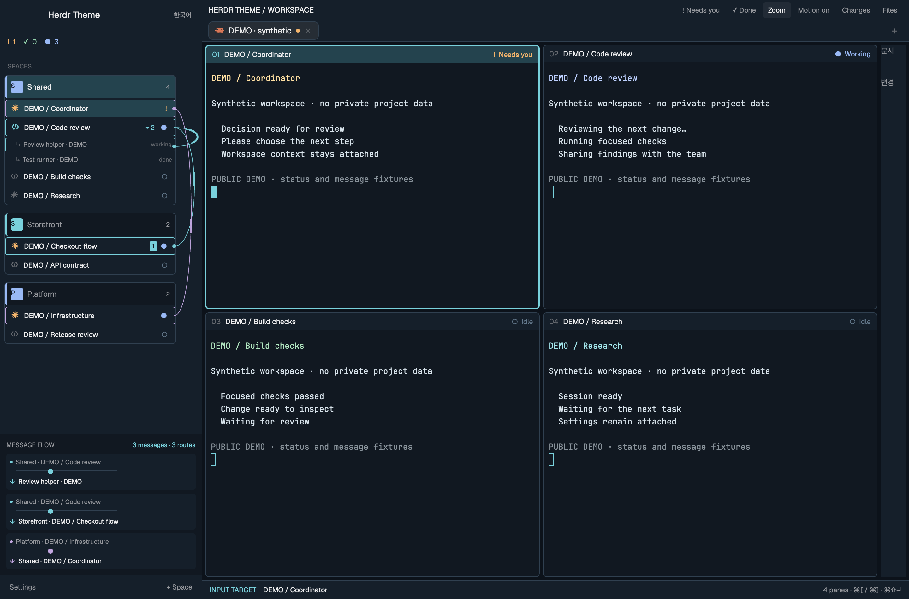
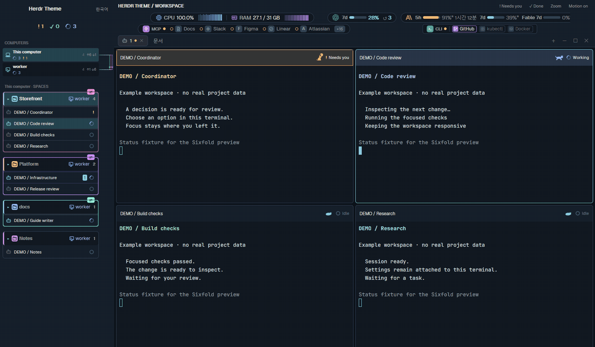

# Herdr Theme

A workspace sidebar and terminal layout for Herdr. Follow coding agents, shared projects and messages across computers, with tools and usage limits beside your terminals.

## Workflow and feature gallery

The walkthrough covers issue context, allocation, parallel work, messages, review requests, verdicts, acceptance, retained context and cleanup. It uses synthetic fixtures and editorial captions: it is not a recording of a real end-to-end task. The still above is a native demo capture, not a guarantee that every optional integration is configured.

[English feature gallery](https://github.com/chanyang721/herdr-theme/blob/main/README.md) · [한국어 기능 안내](https://github.com/chanyang721/herdr-theme/blob/main/README.ko.md) · [Capture sources and timings](https://github.com/chanyang721/herdr-theme/blob/main/docs/media/workflow-manifest.json).

## What you see

- Computers and workspace groups with agent state, shared-project indicators, unread messages and optional issue-linked task trees.
- Terminal headers with model, effort, session usage and animated agent state. Motion can be disabled.
- Optional Workspace Mods indicators for CPU/RAM, MCP connections, CLI sign-in and account plan limits.
- Workspace documents with search, pins and a document tab; an optional file viewer can preview Markdown.
- A compact weekly header chip opening project work, a full timeline and issue detail in overlays. It does not need a permanent large timeline strip. The README shows a navigation diagram; a fresh native screenshot of this feature is not yet included.

Keep the terminal area central. The default layout does not include the old input-target footer. Select rows deliberately; incoming messages and status changes must not steal keyboard focus. Preserve other layouts, user palettes and terminal settings.

## How it behaves

The theme displays observations supplied by Herdr and optional local feed producers. Working, idle, needs-human, unseen-result, cleanup-wait, closing and closed are distinct states. A finished response or a full progress bar alone is not task acceptance or proof of cleanup.

The external harness owns task allocation, file ownership, result retention, acceptance and pane closure. The theme displays its events; installing this layout does not install or configure that service. Parent/child task trees and retained-result stages require the corresponding feed. Account connections and issue updates need separate setup and explicit application.

Message animations require a compatible event adapter or configured local collector. As checked on 2026-11-12, core PR #90 closed unmerged and its successor #167 remains open. Do not assume stock core releases emit those native events. The proposed event uses `data.from` for the sender and envelope `terminal` for the recipient. A send observation is not a read receipt or completion. Automatic launch tasks, keys and automatic parent notes are excluded; allocation is represented separately by the harness feed. See the README compatibility section before enabling routes.

## Built from

Use `layouts/sixfold.json`, `themes/sixfold-night.json`, `themes/sixfold-day.json` and the repository's `mods/` sources. The Rust `herdr-theme` helper installs the layout and pinned Workspace Mods described in `workspace-mods.lock.json`. Follow the README's build, install and update instructions instead of recreating an older screenshot's dimensions or chrome.

Optional document-viewer and system-metrics packages are maintained at https://github.com/chanyang721/herdr-workspace-mods. Local project configuration belongs in ignored `*.local.json` files; start from `config/site.example.json`. No private project folders, credentials or real session identifiers belong in published media.

## Watch out

A theme cannot grant microphone access, restore authentication or implement dictation. Native TUI processes are not imported into core. Remote connections and optional producers need their own configuration. Linux has native helper support but its desktop UI has not been verified; voice and HTML snapshots require macOS.

## Done when

- JavaScript and Rust checks pass for the source being installed.
- The installed affected mods pass `herdr-app check`, and live status has no errors.
- Existing terminal identities and user focus survive layout changes.
- Both appearances and label languages render correctly; motion can be disabled.
- Task and message labels distinguish observed input, acceptance and actual closure.
- README links and tracked media resolve; synthetic captures are clearly labelled.

## Public gallery synchronization

Herdr's gallery discovers the public repository using its `herdr-layout` topic. It reads this `RECIPE.md` and uses `preview.png` for the catalog thumbnail; the README's animated walkthrough is `preview.gif`. The gallery documents discovery within an hour and screens community pictures. A successful Git push does not prove that its cached page or thumbnail has refreshed: verify https://herdr.dev/layouts/chanyang721/herdr-theme/ separately.
