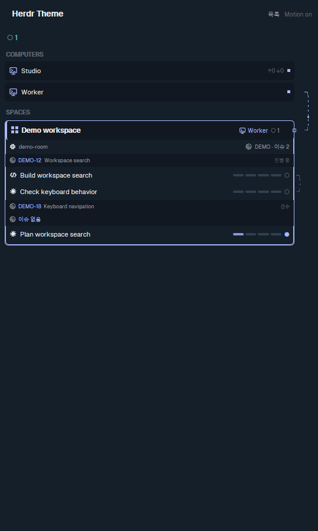

# Native panel fixture gallery

These are native app screenshots rendered from synthetic local feed fixtures.
The capture source is `d6765bba`; image hashes are in the
[manifest](images/panel-feed/manifest.json). These captures use the older host's
compatibility reader. Native JSON-worker and visibility integration is pending
an actual Windows test executable.

The same fixture generator drives model tests, renderer tests and the screenshots.
Each cell below links to its complete native capture.

| Sharing | No tool | No tool + Slack | Linear | Linear + Slack | Jira | Jira + Slack |
| --- | --- | --- | --- | --- | --- | --- |
| None | [View](images/panel-feed/matrix-none-none-no-slack.png) | [View](images/panel-feed/matrix-none-none-slack.png) | [View](images/panel-feed/matrix-none-linear-no-slack.png) | [View](images/panel-feed/matrix-none-linear-slack.png) | [View](images/panel-feed/matrix-none-jira-no-slack.png) | [View](images/panel-feed/matrix-none-jira-slack.png) |
| Space | [View](images/panel-feed/matrix-space-none-no-slack.png) | [View](images/panel-feed/matrix-space-none-slack.png) | [View](images/panel-feed/matrix-space-linear-no-slack.png) | [View](images/panel-feed/matrix-space-linear-slack.png) | [View](images/panel-feed/matrix-space-jira-no-slack.png) | [View](images/panel-feed/matrix-space-jira-slack.png) |
| Agent | [View](images/panel-feed/matrix-agent-none-no-slack.png) | [View](images/panel-feed/matrix-agent-none-slack.png) | [View](images/panel-feed/matrix-agent-linear-no-slack.png) | [View](images/panel-feed/matrix-agent-linear-slack.png) | [View](images/panel-feed/matrix-agent-jira-no-slack.png) | [View](images/panel-feed/matrix-agent-jira-slack.png) |

Additional layouts: [state sorting](images/panel-feed/scenario-sorting.png),
[overflow](images/panel-feed/scenario-overflow.png),
[unassigned issues](images/panel-feed/scenario-no-issue.png),
[cross-space](images/panel-feed/scenario-cross-space.png), and
[cross-computer](images/panel-feed/scenario-cross-computer.png).

Transitions: [distribution](images/panel-feed/event-dispatch-existing-01.png),
[new session](images/panel-feed/event-spawn-01.png),
[message](images/panel-feed/event-message-01.png),
[space message](images/panel-feed/event-message-space-01.png),
[computer message](images/panel-feed/event-message-computer-01.png),
[review request](images/panel-feed/event-review_request-01.png),
[verdict](images/panel-feed/event-verdict-01.png),
[acceptance](images/panel-feed/event-accept-01.png),
[closing 1](images/panel-feed/event-close-1-01.png),
[closing 2](images/panel-feed/event-close-2-01.png),
[closing 3](images/panel-feed/event-close-3-01.png),
[closing 4 after its label expires](images/panel-feed/event-close-4-08.png),
[blocked closing](images/panel-feed/event-blocked-close-01.png), and
[memory proposal](images/panel-feed/event-memory-01.png).

[Light theme](images/panel-feed/light-shared-space.png) and
[motion off](images/panel-feed/motion-off-a.png) retain the same information.
Comparing two motion-off captures produced zero differing pixels. The title
region also had zero differing pixels when a distribution label returned to its
stage bar. Consecutive native captures show the four-pixel message packet moving.

## Compatibility-host measurements

The test app ran in an isolated desktop with synthetic data. Process CPU is
normalized over 16 logical processors. The large fixture has 20 spaces and 60
agents; data-update measurements used motion off.

| Observation | Result |
| --- | --- |
| Unchanged feed, 20 seconds | File reads, callbacks, watch batches, panel notifications and native render increments: 0 |
| Unchanged-feed process cost | 0.068% machine CPU; private memory decreased by 53 KiB |
| 25 Hz producer, 500 writes | Intentional 150 ms coalescing delivered 130 snapshots; final revision visible; pending delivery and reads: 0 |
| Partial updates in that run | Target row rendered 130 times; other 59 rows, 20 cards and retained root/list: 0 |
| Five independent markers during 25 Hz writes to another row | 5/5 observed; screenshot-completion bounds 65–280 ms |
| Separate no-capture burst, 125 native window renders | Mean render cost 9.525 ms |
| One-second render-duration sums in that burst | p50 61.655 ms; p95 69.154 ms; p99 71.213 ms |
| Normal navigator, two native spaces | Icon 158 ms; badge 247 ms; only the matching card redrawn |
| Shared external directory, two copies | One root watch; both callbacks arrived in 127 ms |

The duration quantiles describe one-second sums, not individual frames. Physical
presentation FPS and individual frame percentiles were not measured. Bounded
producer retries handled transient Windows atomic-replace contention; all 500
writes were accepted. Intermediate states are intentionally coalesced.

Native `space.select` and `pane.focus` actions also updated selection highlighting
with the feed bytes and modification time unchanged. Only the old and new cards
redrew, including with two copies. Mouse clicks, hover and drag were not physically
replayed in this isolated desktop; navigation callbacks have automated tests.
