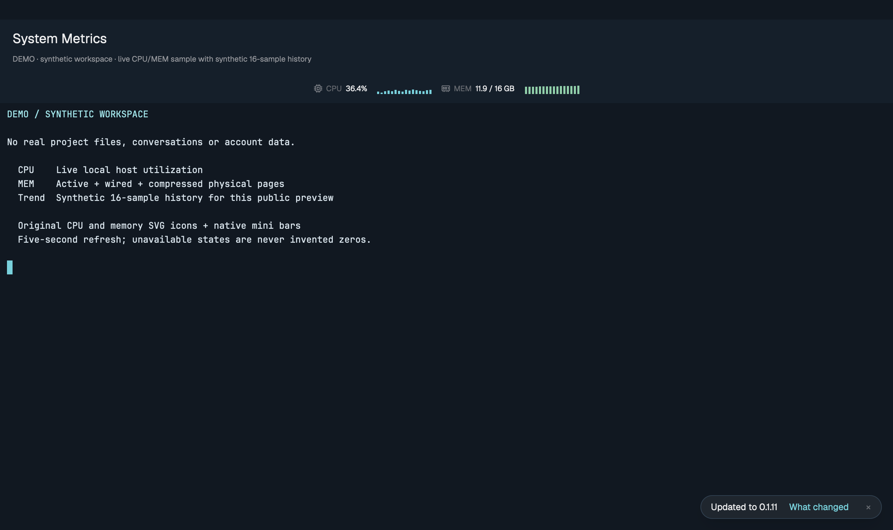

# System Metrics

See your Mac’s CPU utilization and physical memory use in a compact native strip, alongside your terminal work.

## What you see
A native horizontal strip inherits the current theme. Original CPU and memory icons accompany the values and two compact 16-sample history graphs. CPU is a percent of total machine capacity. MEM shows active + wired + compressed physical pages in GiB beside installed physical memory. This is not Activity Monitor memory pressure or per-process allocation.

## How it behaves
Bars show relative utilization over the latest 16 successful observations (about 80 seconds); a fresh window builds history from new samples. Refresh every five seconds, with no overlapping samples. A failed refresh preserves the last value with an asterisk and an error label; unavailable data is shown as a dash, never a fabricated zero. No keys, network, animation or terminal focus changes.

## Built from
`mods/system-metrics/main.js` uses gpui-kit, gpui-base, theme, appHome and exec. Python 3 runs `top -l 2 -s 1 -n 0`, vm_stat and sysctl with bounded timeouts. There is no daemon, hook or credential access. Manifest place top; a personal layout may position one instance explicitly.

## Watch out
macOS only. Sampling reads host-wide counters and executes system programs. It is not a token meter or subscription quota. For those use the separately installed Insights or Usage Bar projects.

## Done when
Native check passes; a live sample returns bounded CPU and physical bytes; errors stay visibly unavailable/stale; existing terminals retain their PID and focus.
